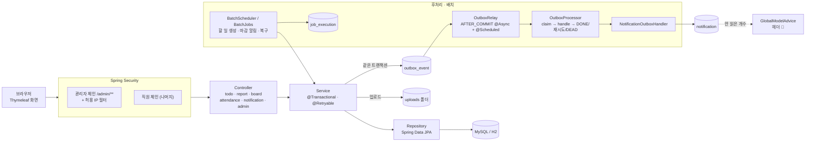
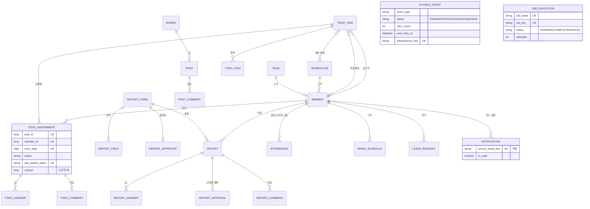
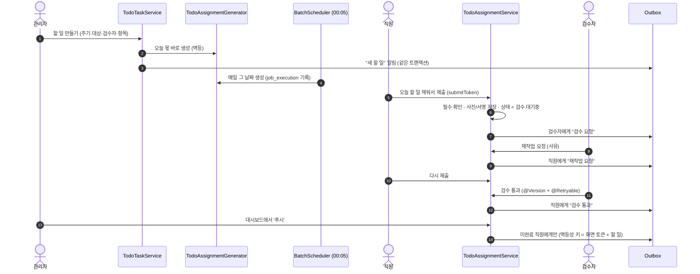
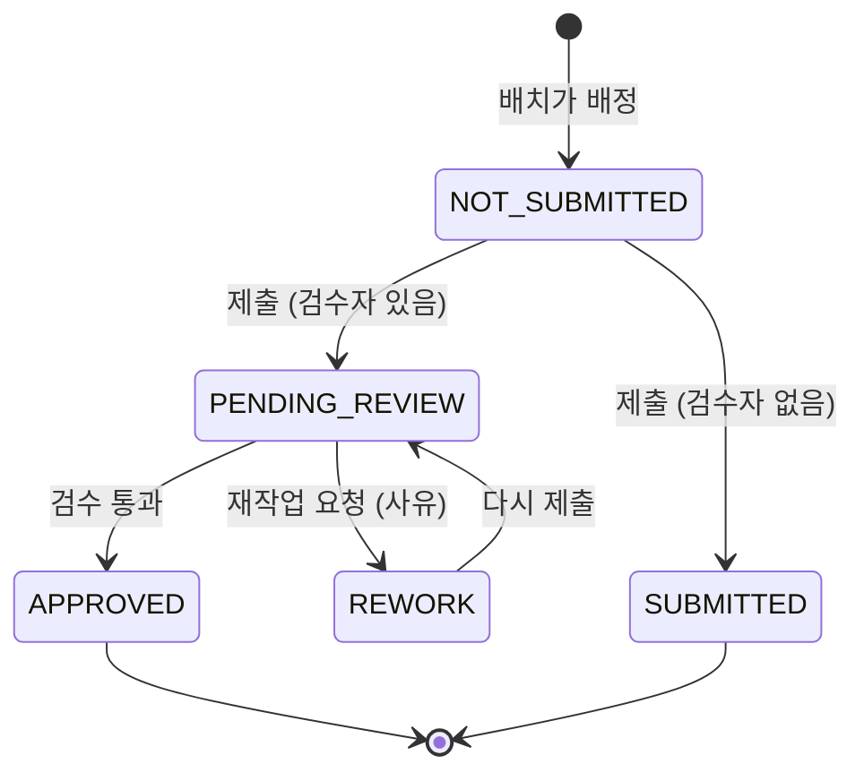
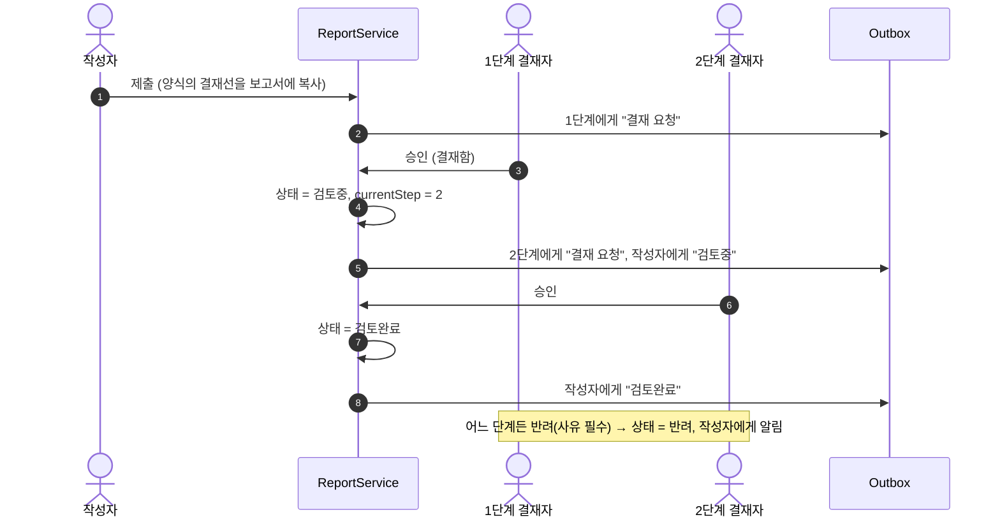
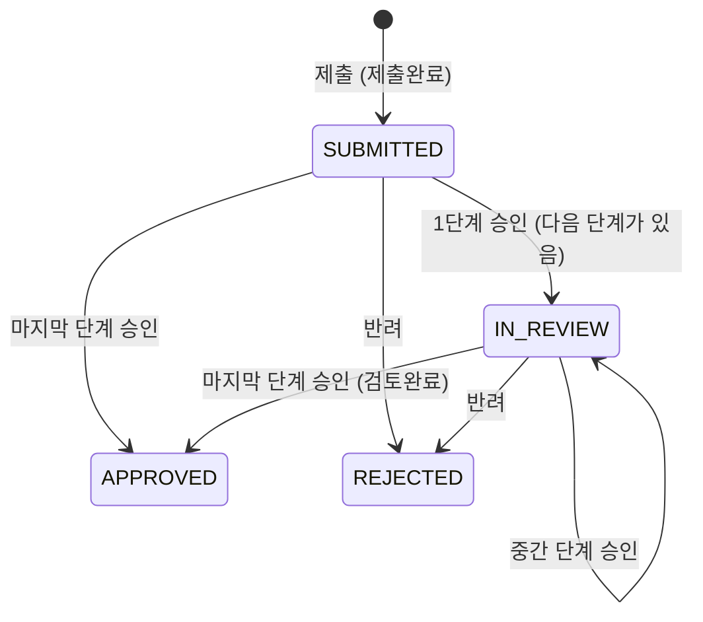
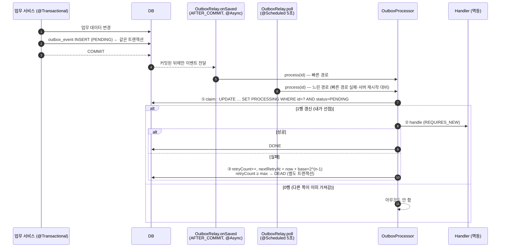
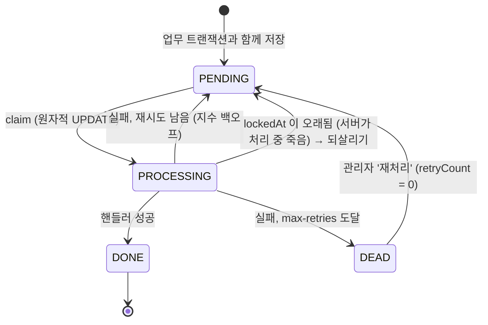
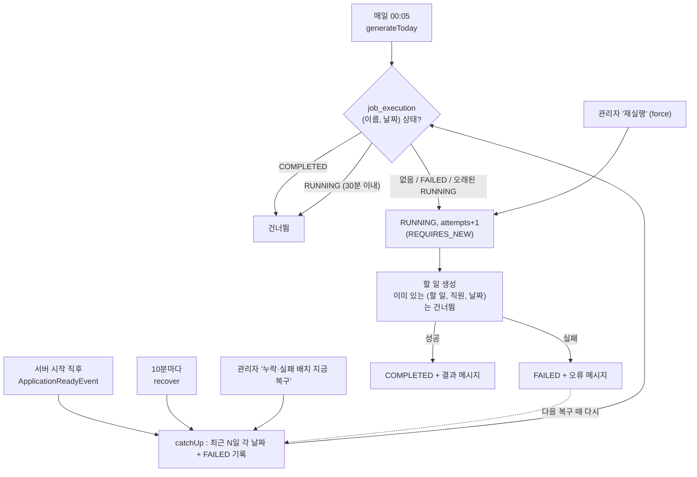
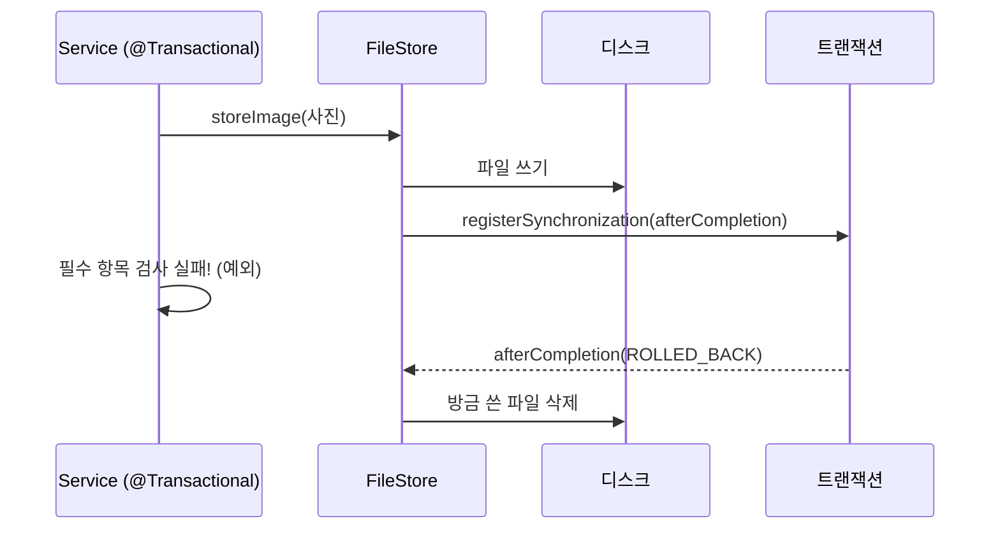

# InhaWorks 아키텍처

> 사내 업무 관리 웹앱 **InhaWorks** 의 구조, 업무 흐름, 그리고 "실패해도 일이 사라지지 않게" 만든 신뢰성 장치를 그림으로 정리한 문서예요.
> 그림은 Mermaid 로 그렸어요 (GitHub, IntelliJ Markdown 미리보기에서 바로 보여요).

## 목차

1. [전체 구조 (계층)](#1-전체-구조-계층)
2. [도메인 ER 개요](#2-도메인-er-개요)
3. [할 일 : 배정 → 제출 → 검수](#3-할-일--배정--제출--검수)
4. [보고서 : 다단계 결재](#4-보고서--다단계-결재)
5. [Transactional Outbox : 재시도 · DEAD · 수동 재처리](#5-transactional-outbox--재시도--dead--수동-재처리)
6. [배치 실행 기록과 복구 (catch-up)](#6-배치-실행-기록과-복구-catch-up)
7. [전처리 : 파일 보상 삭제 · 중복 제출 방지 · 재시도](#7-전처리--파일-보상-삭제--중복-제출-방지--재시도)
8. [장애 대응 표 (어디서 실패하면 무엇이 막아 주나)](#8-장애-대응-표)
9. [보안](#9-보안)

<br>

## 1. 전체 구조 (계층)

기능(도메인)마다 패키지를 나누고, 각 패키지 안은 `controller → service → repository → entity` 같은 구조예요.
알림 같은 **후처리는 업무 서비스가 직접 하지 않고** Outbox 테이블에 적어 두면 릴레이가 처리해요.



| 패키지 | 하는 일 |
|---|---|
| `config` | 보안(관리자/직원 체인, IP 필터), 재시도·비동기, 스케줄링, 예시 데이터 |
| `common` | 파일 저장(보상 삭제), 반복 규칙, 공통 화면 값, 오류 화면 |
| `organization` | 팀, 근무지(매장) |
| `member` / `admin` | 직원 로그인, 내 정보 / 직원 관리, 재처리 모니터 |
| `todo` | 반복 할 일, 직원별 하루 할 일, 제출·검수·댓글 |
| `report` | 보고서 양식(폼 빌더), 제출, 결재, 엑셀·zip |
| `board` | 게시판, 글, 이슈 상태, 댓글 |
| `attendance` | 출퇴근, 스케줄, 휴가 |
| `notification` | 앱 안 알림 |
| `outbox` | Transactional Outbox (저장 · 릴레이 · 처리기) |
| `batch` | 배치 실행 기록, 생성·마감·복구 배치 |

<br>

## 2. 도메인 ER 개요



중복을 막는 **unique 제약**

| 테이블 | unique | 막는 것 |
|---|---|---|
| `todo_assignment` | (task, member, work_date) | 배치를 여러 번 돌려도 같은 날 같은 사람에게 두 번 배정 |
| `todo_assignment` | last_submit_token | 제출 더블클릭 |
| `report` / `post` | submit_token | 보고서·글 중복 등록 |
| `attendance` | (member, work_date) | 출근 두 번 |
| `outbox_event` | idempotency_key | 푸시 더블클릭 등 같은 요청으로 이벤트 두 번 |
| `notification` | source_event_key | 같은 이벤트를 두 번 처리해도 알림은 한 번 |
| `job_execution` | (job_name, job_key) | 같은 날짜 배치 기록 한 줄 |

<br>

## 3. 할 일 : 배정 → 제출 → 검수





| 상태 | 화면 이름 |
|---|---|
| NOT_SUBMITTED | 제출 미완료 |
| SUBMITTED | 제출 완료 |
| PENDING_REVIEW | 검수 대기중 |
| APPROVED | 검수 통과 |
| REWORK | 재작업 필요 |

반복 규칙 (`RecurrenceRule`)
- DAILY : 시작일 ~ 종료일 매일
- WEEKLY : 고른 요일 (`MONDAY,WEDNESDAY`)
- MONTHLY : 매월 N일, 그 달에 없으면 말일 (31일 → 2월 28일)

<br>

## 4. 보고서 : 다단계 결재





- 결재함은 "대기 중이고, 보고서의 현재 단계가 내 단계"인 결재만 보여 줘요. 2단계 결재자가 1단계보다 먼저 누르면 "결재 차례가 아니에요".
- 관리자는 양식별 **엑셀**(제출 전체, 항목이 열)과 **첨부 zip**(이미지·문서·서명)을 받을 수 있어요.

<br>

## 5. Transactional Outbox : 재시도 · DEAD · 수동 재처리

### 왜 필요한가
업무 처리(예: 검수 통과)와 알림을 따로 하면 이런 일이 생겨요.
- DB 저장은 됐는데 알림 직전에 서버가 죽음 → **알림 유실**
- 알림은 보냈는데 DB 저장이 롤백됨 → **없는 일에 대한 알림**

그래서 업무 데이터와 "할 일 메모(Outbox 이벤트)"를 **같은 트랜잭션**으로 저장하고, 알림은 그 메모를 읽어서 따로 처리해요.
`OutboxService.publish()` 는 `Propagation.MANDATORY` 라서 업무 트랜잭션 밖에서는 부를 수조차 없어요.





| 장치 | 코드 | 설명 |
|---|---|---|
| 같은 트랜잭션 저장 | `OutboxService.publish` (MANDATORY) | 업무와 이벤트가 같이 커밋/롤백 |
| 빠른 경로 | `OutboxRelay.onSaved` (`@TransactionalEventListener(AFTER_COMMIT)` + `@Async`) | 커밋 직후 별도 스레드에서 처리 → 알림이 거의 즉시 |
| 느린 경로 | `OutboxRelay.poll` (`@Scheduled`) | PENDING 을 주기적으로 훑음 → 결국은 처리됨 |
| 원자적 선점 | `OutboxEventRepository.claim` | 두 경로가 동시에 집어도 한쪽만 처리 |
| 지수 백오프 | `OutboxEvent.markFailed` | 10s, 20s, 40s … 최대 1시간 |
| DEAD | `max-retries` (기본 5) | 계속 실패하면 멈추고 사람이 보게 |
| 멈춘 이벤트 복구 | `releaseStuck` | PROCESSING 으로 5분 넘게 멈추면 PENDING 으로 |
| 멱등 핸들러 | `Notification.sourceEventKey` unique | 같은 이벤트가 두 번 와도 알림은 한 번 (at-least-once 전달이므로 필수) |
| 멱등성 키 | `OutboxEvent.idempotencyKey` unique | 푸시 버튼 더블클릭, 마감 알림 하루 한 번 |
| 수동 재처리 | 관리자 > 재처리 모니터 | DEAD → PENDING, 횟수 0 |

<br>

## 6. 배치 실행 기록과 복구 (catch-up)

`job_execution` 에 (배치 이름, 날짜) 마다 한 줄씩 기록해서 "그 날짜를 끝냈는지"를 DB 로 판단해요.



- 서버가 3일 꺼져 있다가 켜지면 → 시작 직후 catch-up 이 빠진 3일치 할 일을 만들어요.
- 생성 작업 자체가 멱등이라 **강제 재실행(force)** 해도 중복이 생기지 않아요.
- 마감 알림(`TODO_DEADLINE_NOTIFY`)은 1분마다 "마감 시각이 지났는가"를 보고, 그날 한 번만 실행돼요 (job_execution + 멱등성 키 이중 방어).

<br>

## 7. 전처리 : 파일 보상 삭제 · 중복 제출 방지 · 재시도

### 업로드 파일 보상 삭제
파일은 디스크에, 기록은 DB 에 저장돼요. DB 가 롤백되면 디스크 파일만 남는 "고아 파일"이 생기므로,
`FileStore` 가 파일을 저장할 때 `TransactionSynchronization` 을 등록해 두고 **커밋되지 않으면 지워요** (보상, compensation).



### 중복 제출 방지 (멱등성 토큰)
화면을 열 때 숨은 `submitToken`(UUID)을 만들어 두고, 서버는
- 할 일 : 지난번 제출 토큰과 같으면 무시
- 보고서·게시글 : 같은 토큰으로 만든 것이 있으면 그것을 돌려줌 (unique 제약이 동시 요청까지 막음)
- 화면에서도 `data-once` 로 제출 버튼을 잠가요

### 일시적인 DB 오류 재시도
Spring Framework 7 에 들어간 `@Retryable` (`org.springframework.resilience.annotation`) 을 `@EnableResilientMethods` 로 켰어요.

```java
@Retryable(includes = {ConcurrencyFailureException.class, TransientDataAccessException.class,
        CannotCreateTransactionException.class}, maxRetries = 3, delay = 100, multiplier = 2)
public TodoAssignment review(...)   // 검수 / 결재 / 출퇴근 / 휴가 승인 / 할 일 제출
```

- `@EnableResilientMethods(order = HIGHEST_PRECEDENCE)` → 재시도 프록시가 트랜잭션 프록시 **바깥**에 있어서, 재시도마다 **새 트랜잭션**이 열려요.
- `@Version`(낙관적 락) 과 함께 써서, 두 검수자가 동시에 누르면 늦은 쪽은 충돌 → 재시도 → 최신 상태(이미 통과)를 읽고 "이미 처리된 할 일이에요" 로 안내해요.

<br>

## 8. 장애 대응 표

| 실패 지점 | 생길 수 있는 문제 | 막는 장치 | 위치 |
|---|---|---|---|
| 업무 저장 후 알림 전에 서버 종료 | 알림 유실 | Outbox 같은 트랜잭션 저장 + 스케줄러 재처리 | `OutboxService`, `OutboxRelay.poll` |
| 업무 트랜잭션 롤백 | 없는 일에 대한 알림 | Outbox 행도 같이 롤백, 빠른 경로는 AFTER_COMMIT | `OutboxRelay.onSaved` |
| 알림 처리 중 예외 | 알림 유실 | retryCount++, 지수 백오프 재시도 | `OutboxProcessor`, `OutboxEvent.markFailed` |
| 계속 실패 | 무한 재시도 | max-retries 후 DEAD → 모니터에서 수동 재처리 | `MonitorController` |
| 처리 중(PROCESSING) 서버 종료 | 이벤트가 영원히 멈춤 | lockedAt 타임아웃 후 PENDING 되살리기 | `releaseStuck` |
| 빠른 경로와 스케줄러가 동시에 처리 | 알림 두 번 | 원자적 claim UPDATE + 알림 sourceEventKey unique | `claim`, `Notification` |
| 푸시 버튼 더블클릭 | 알림 두 번 | Outbox idempotencyKey unique | `TodoAssignmentService.remind` |
| 서버가 며칠 꺼짐 | 그 날짜 할 일 없음 | job_execution + 시작 시 catch-up | `BatchJobs.catchUp` |
| 생성 배치 실패 | 그 날짜 할 일 없음 | FAILED 기록 → 10분마다 재시도, 모니터 '재실행' | `JobExecutionService` |
| 배치 두 번 실행 | 할 일 중복 | (task, member, date) unique + 이미 있는 직원 건너뛰기 | `TodoAssignmentGenerator` |
| 두 검수자/결재자 동시 처리 | 상태 덮어쓰기 | `@Version` 낙관적 락 + `@Retryable` | `TodoAssignment`, `Report` |
| DB 일시 장애·락 타임아웃 | 요청 실패 | `@Retryable` 100ms → 200ms → 400ms | 서비스 메서드 |
| 파일 저장 후 DB 롤백 | 고아 파일 | TransactionSynchronization 보상 삭제 | `FileStore` |
| 제출 더블클릭·새로고침 재전송 | 중복 제출 | submitToken (unique) | 할 일·보고서·게시글 |
| 출근 두 번 | 기록 두 줄 | (member, date) unique | `Attendance` |

<br>

## 9. 보안

| 항목 | 내용 | 설정 |
|---|---|---|
| 로그인 분리 | `/admin/**` 는 관리자 체인(관리자 로그인 화면, ADMIN 만), 나머지는 직원 체인 | `SecurityConfig` |
| 관리자 IP 제한 | 허용 IP(앞부분 일치)만 `/admin/**` 접근, 비우면 제한 없음 | `app.security.admin-allowed-ips` |
| 일괄 다운로드 제한 | 엑셀·zip 은 관리자만, 설정으로 끌 수 있음 (다운로드는 로그로 남김) | `app.security.bulk-download-enabled` |
| 퇴사 처리 | 지우지 않고 비활성화 → 로그인 불가, 새 할 일 배정 제외 | `Member.active` |
| 세부 권한 | 검수자·결재자 본인인지 서비스에서 확인 | `canReview`, `canDecide` |
| 업로드 | 확장자 허용 목록, 파일 이름은 UUID, `/uploads/**` 도 로그인 필요 | `FileStore` |
