# InhaWorks 아키텍처

> 사내 업무 관리 웹앱 **InhaWorks** 의 구조, 업무 흐름, 그리고 "실패해도 일이 사라지지 않게" 만든 신뢰성 장치를 그림으로 정리한 문서예요.
> 그림은 Mermaid 로 그렸어요 (GitHub, IntelliJ Markdown 미리보기에서 바로 보여요).

## 목차

1. [전체 구조 (계층)](#1-전체-구조-계층)
2. [도메인 ER 개요](#2-도메인-er-개요)
3. [할 일 : 배정 → 제출 → 검수](#3-할-일--배정--제출--검수)
4. [보고서 : 다단계 결재](#4-보고서--다단계-결재)
5. [Transactional Outbox : 재시도 · DEAD · 수동 재처리](#5-transactional-outbox--재시도--dead--수동-재처리)
6. [배치 실행 기록과 복구 (catch-up)](#6-배치-실행-기록과-복구-catch-up)
7. [전처리 : 파일 보상 삭제 · 중복 제출 방지 · 재시도](#7-전처리--파일-보상-삭제--중복-제출-방지--재시도)
8. [장애 대응 표 (어디서 실패하면 무엇이 막아 주나)](#8-장애-대응-표)
9. [보안](#9-보안)
10. [방어 설계와 롤백 검증](#10-방어-설계와-롤백-검증)
11. [이슈 고도화 · 사내 채팅 워크플로 (DOC-01 ~ 10)](#11-이슈-고도화--사내-채팅-워크플로-doc-01--10)

<br>

## 1. 전체 구조 (계층)

기능(도메인)마다 패키지를 나누고, 각 패키지 안은 `controller → service → repository → entity` 같은 구조예요.
알림 같은 **후처리는 업무 서비스가 직접 하지 않고** Outbox 테이블에 적어 두면 릴레이가 처리해요.

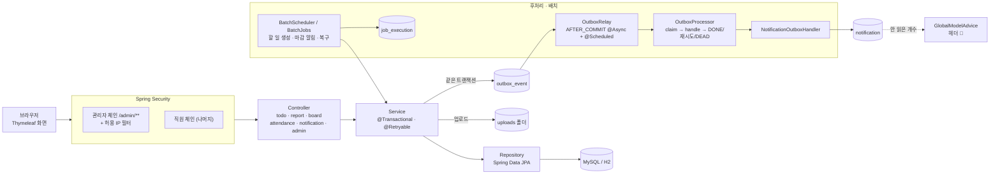

| 패키지 | 하는 일 |
|---|---|
| `config` | 보안(관리자/직원 체인, IP 필터), 재시도·비동기, 스케줄링, 예시 데이터 |
| `common` | 파일 저장(보상 삭제), 반복 규칙, 공통 화면 값, 오류 화면 |
| `organization` | 팀, 근무지(매장) |
| `member` / `admin` | 직원 로그인, 내 정보 / 직원 관리, 재처리 모니터 |
| `todo` | 반복 할 일, 직원별 하루 할 일, 제출·검수·댓글 |
| `report` | 보고서 양식(폼 빌더), 제출, 결재, 엑셀·zip |
| `board` | 게시판, 글, 이슈 5단계·상태 이력·내보내기, 댓글 |
| `attendance` | 출퇴근, 스케줄, 휴가, 근무 정책(근무제)·근무 유형 (`WorkPolicyService`) |
| `hr` | 직원 허브, 인사 서류 종류·직원 서류(비공개 파일 + 열람 권한), 인사 변경 이력, 계약 만료·복직 알림 (`HrService`, `HrHistoryService`) |
| `chat` | 사내 채팅 : 대화방, 메시지, 읽음, 멘션, 문의 채널, 프로필 카드, 관리자 문의함 |
| `notification` | 앱 안 알림 |
| `outbox` | Transactional Outbox (저장 · 릴레이 · 처리기) |
| `batch` | 배치 실행 기록, 생성·마감·복구 배치 |

<br>

## 2. 도메인 ER 개요

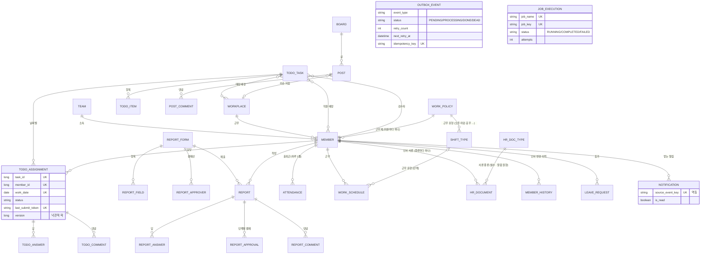

중복을 막는 **unique 제약**

| 테이블 | unique | 막는 것 |
|---|---|---|
| `todo_assignment` | (task, member, work_date) | 배치를 여러 번 돌려도 같은 날 같은 사람에게 두 번 배정 |
| `todo_assignment` | last_submit_token | 제출 더블클릭 |
| `report` / `post` | submit_token | 보고서·글 중복 등록 |
| `attendance` | (member, work_date) | 출근 두 번 |
| `hr_document` | (member, type) | 같은 서류 두 장 (다시 올리면 교체) |
| `outbox_event` | idempotency_key | 푸시 더블클릭 등 같은 요청으로 이벤트 두 번 |
| `notification` | source_event_key | 같은 이벤트를 두 번 처리해도 알림은 한 번 |
| `job_execution` | (job_name, job_key) | 같은 날짜 배치 기록 한 줄 |

<br>

## 3. 할 일 : 배정 → 제출 → 검수

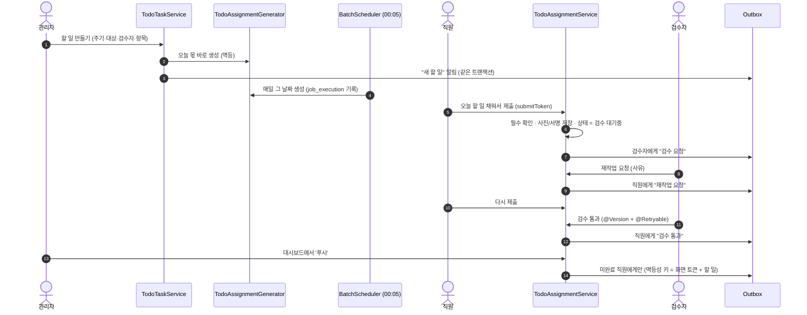

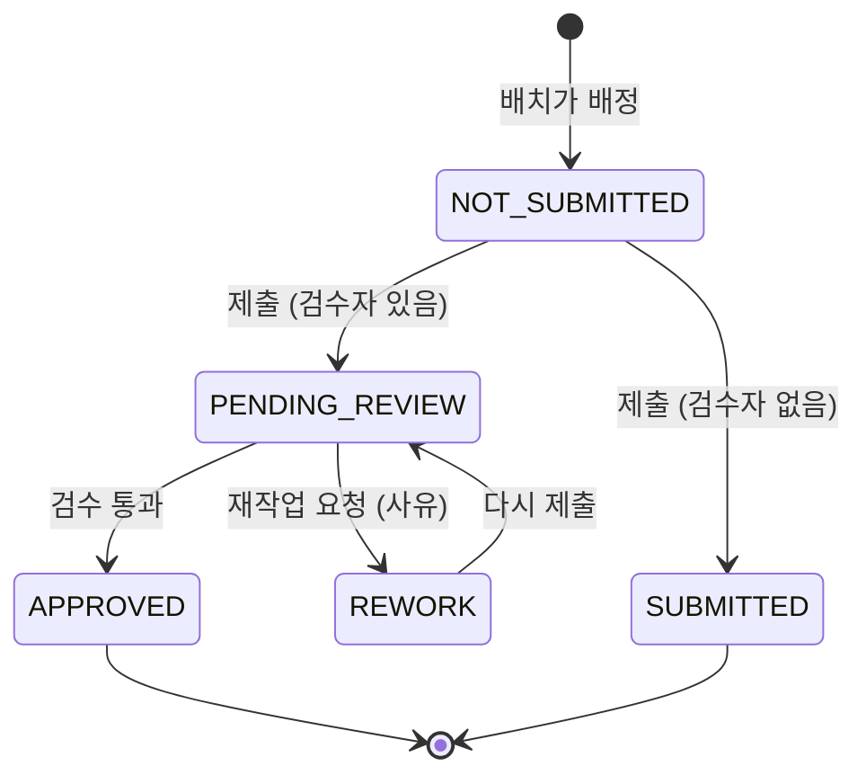

| 상태 | 화면 이름 |
|---|---|
| NOT_SUBMITTED | 제출 미완료 |
| SUBMITTED | 제출 완료 |
| PENDING_REVIEW | 검수 대기중 |
| APPROVED | 검수 통과 |
| REWORK | 재작업 필요 |

반복 규칙 (`RecurrenceRule`)
- DAILY : 시작일 ~ 종료일 매일
- WEEKLY : 고른 요일 (`MONDAY,WEDNESDAY`)
- MONTHLY : 매월 N일, 그 달에 없으면 말일 (31일 → 2월 28일)

<br>

## 4. 보고서 : 다단계 결재

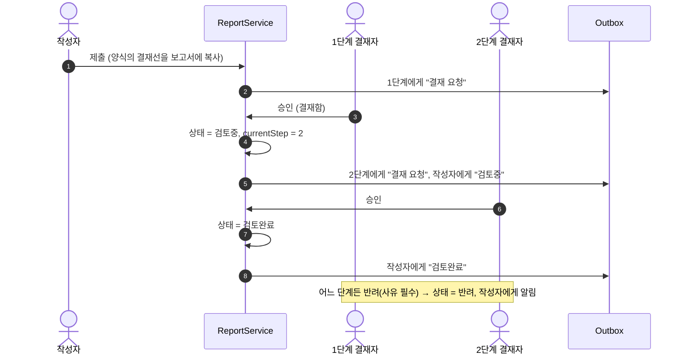

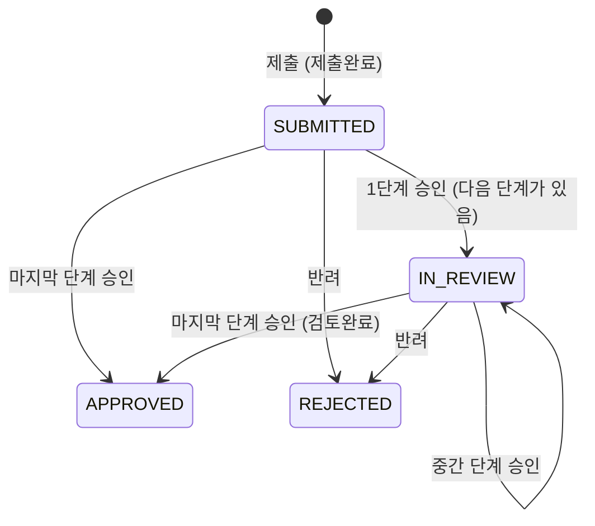

- 결재함은 "대기 중이고, 보고서의 현재 단계가 내 단계"인 결재만 보여 줘요. 2단계 결재자가 1단계보다 먼저 누르면 "결재 차례가 아니에요".
- 관리자는 양식별 **엑셀**(제출 전체, 항목이 열)과 **첨부 zip**(이미지·문서·서명)을 받을 수 있어요.

<br>

## 5. Transactional Outbox : 재시도 · DEAD · 수동 재처리

### 왜 필요한가
업무 처리(예: 검수 통과)와 알림을 따로 하면 이런 일이 생겨요.
- DB 저장은 됐는데 알림 직전에 서버가 죽음 → **알림 유실**
- 알림은 보냈는데 DB 저장이 롤백됨 → **없는 일에 대한 알림**

그래서 업무 데이터와 "할 일 메모(Outbox 이벤트)"를 **같은 트랜잭션**으로 저장하고, 알림은 그 메모를 읽어서 따로 처리해요.
`OutboxService.publish()` 는 `Propagation.MANDATORY` 라서 업무 트랜잭션 밖에서는 부를 수조차 없어요.

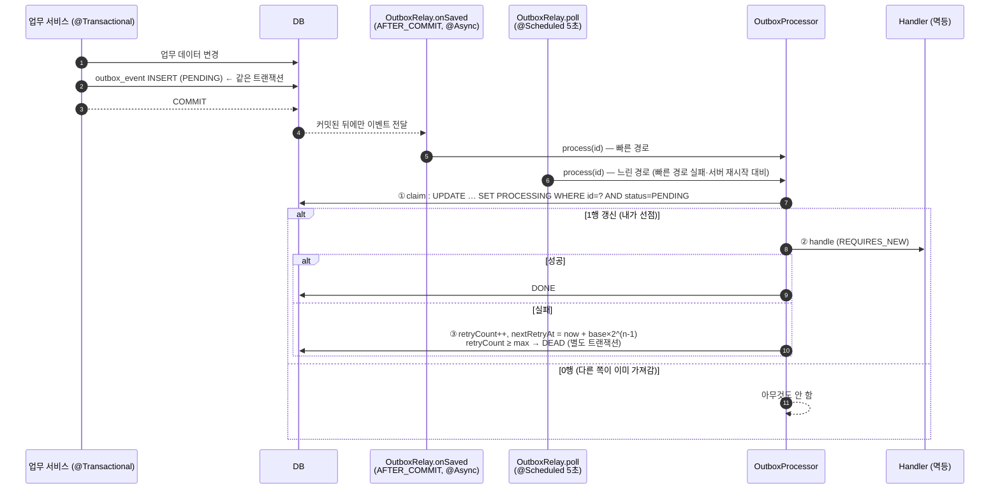

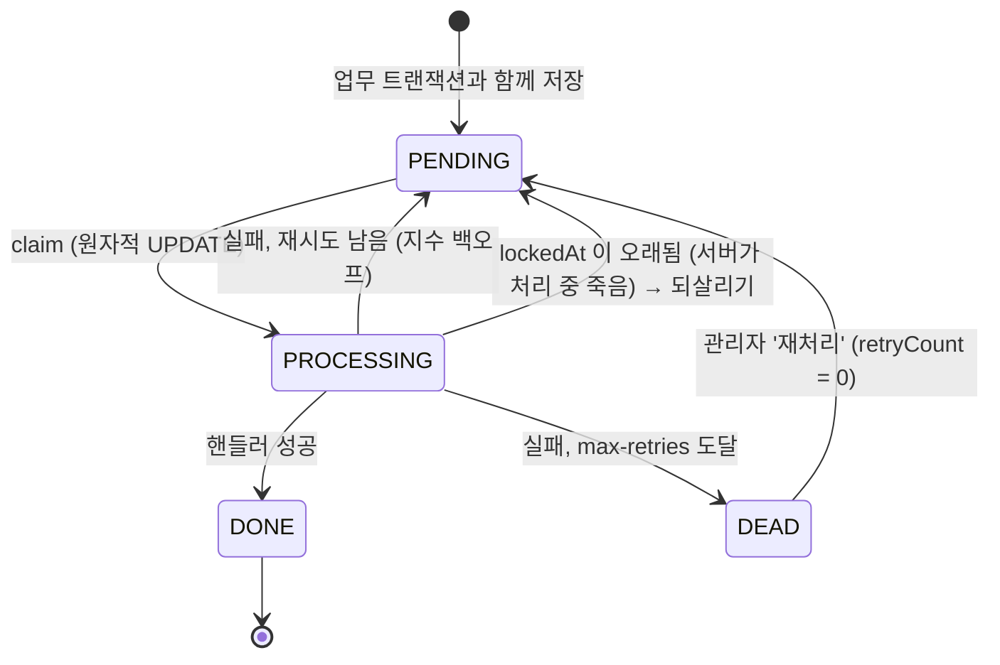

| 장치 | 코드 | 설명 |
|---|---|---|
| 같은 트랜잭션 저장 | `OutboxService.publish` (MANDATORY) | 업무와 이벤트가 같이 커밋/롤백 |
| 빠른 경로 | `OutboxRelay.onSaved` (`@TransactionalEventListener(AFTER_COMMIT)` + `@Async`) | 커밋 직후 별도 스레드에서 처리 → 알림이 거의 즉시 |
| 느린 경로 | `OutboxRelay.poll` (`@Scheduled`) | PENDING 을 주기적으로 훑음 → 결국은 처리됨 |
| 원자적 선점 | `OutboxEventRepository.claim` | 두 경로가 동시에 집어도 한쪽만 처리 |
| 지수 백오프 | `OutboxEvent.markFailed` | 10s, 20s, 40s … 최대 1시간 |
| DEAD | `max-retries` (기본 5) | 계속 실패하면 멈추고 사람이 보게 |
| 멈춘 이벤트 복구 | `releaseStuck` | PROCESSING 으로 5분 넘게 멈추면 PENDING 으로 |
| 멱등 핸들러 | `Notification.sourceEventKey` unique | 같은 이벤트가 두 번 와도 알림은 한 번 (at-least-once 전달이므로 필수) |
| 멱등성 키 | `OutboxEvent.idempotencyKey` unique | 푸시 버튼 더블클릭, 마감 알림 하루 한 번 |
| 수동 재처리 | 관리자 > 재처리 모니터 | DEAD → PENDING, 횟수 0 |

<br>

## 6. 배치 실행 기록과 복구 (catch-up)

`job_execution` 에 (배치 이름, 날짜) 마다 한 줄씩 기록해서 "그 날짜를 끝냈는지"를 DB 로 판단해요.

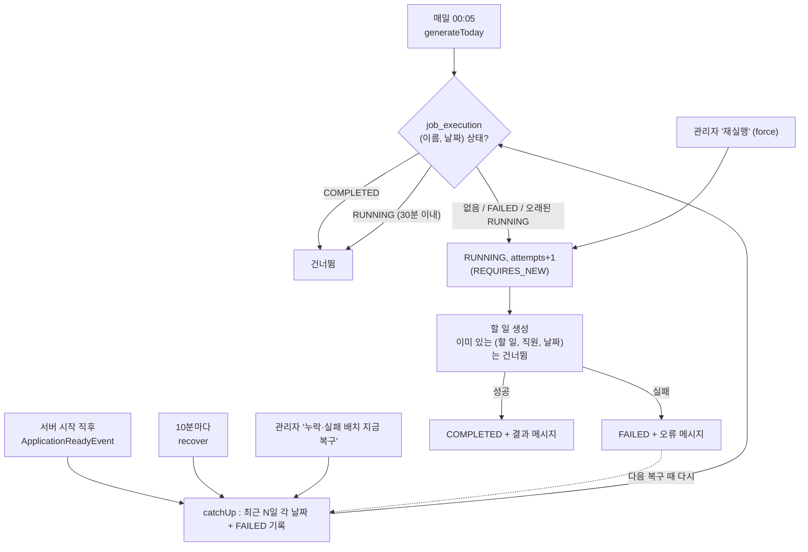

- 서버가 3일 꺼져 있다가 켜지면 → 시작 직후 catch-up 이 빠진 3일치 할 일을 만들어요.
- 생성 작업 자체가 멱등이라 **강제 재실행(force)** 해도 중복이 생기지 않아요.
- 마감 알림(`TODO_DEADLINE_NOTIFY`)은 1분마다 "마감 시각이 지났는가"를 보고, 그날 한 번만 실행돼요 (job_execution + 멱등성 키 이중 방어).

<br>

## 7. 전처리 : 파일 보상 삭제 · 중복 제출 방지 · 재시도

### 업로드 파일 보상 삭제
파일은 디스크에, 기록은 DB 에 저장돼요. DB 가 롤백되면 디스크 파일만 남는 "고아 파일"이 생기므로,
`FileStore` 가 파일을 저장할 때 `TransactionSynchronization` 을 등록해 두고 **커밋되지 않으면 지워요** (보상, compensation).

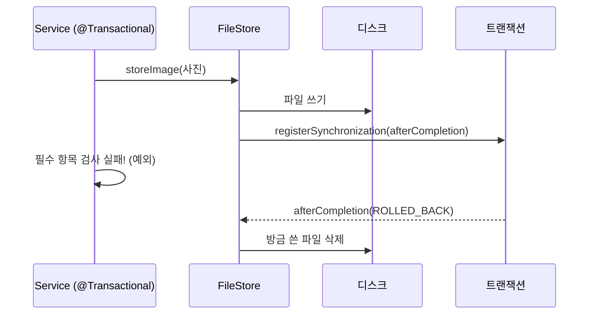

### 중복 제출 방지 (멱등성 토큰)
화면을 열 때 숨은 `submitToken`(UUID)을 만들어 두고, 서버는
- 할 일 : 지난번 제출 토큰과 같으면 무시
- 보고서·게시글 : 같은 토큰으로 만든 것이 있으면 그것을 돌려줌 (unique 제약이 동시 요청까지 막음)
- 화면에서도 `data-once` 로 제출 버튼을 잠가요

### 일시적인 DB 오류 재시도
Spring Framework 7 에 들어간 `@Retryable` (`org.springframework.resilience.annotation`) 을 `@EnableResilientMethods` 로 켰어요.

```java
@Retryable(includes = {ConcurrencyFailureException.class, TransientDataAccessException.class,
        CannotCreateTransactionException.class}, maxRetries = 3, delay = 100, multiplier = 2)
public TodoAssignment review(...)   // 검수 / 결재 / 출퇴근 / 휴가 승인 / 할 일 제출
```

- `@EnableResilientMethods(order = HIGHEST_PRECEDENCE)` → 재시도 프록시가 트랜잭션 프록시 **바깥**에 있어서, 재시도마다 **새 트랜잭션**이 열려요.
- `@Version`(낙관적 락) 과 함께 써서, 두 검수자가 동시에 누르면 늦은 쪽은 충돌 → 재시도 → 최신 상태(이미 통과)를 읽고 "이미 처리된 할 일이에요" 로 안내해요.

<br>

## 8. 장애 대응 표

| 실패 지점 | 생길 수 있는 문제 | 막는 장치 | 위치 |
|---|---|---|---|
| 업무 저장 후 알림 전에 서버 종료 | 알림 유실 | Outbox 같은 트랜잭션 저장 + 스케줄러 재처리 | `OutboxService`, `OutboxRelay.poll` |
| 업무 트랜잭션 롤백 | 없는 일에 대한 알림 | Outbox 행도 같이 롤백, 빠른 경로는 AFTER_COMMIT | `OutboxRelay.onSaved` |
| 알림 처리 중 예외 | 알림 유실 | retryCount++, 지수 백오프 재시도 | `OutboxProcessor`, `OutboxEvent.markFailed` |
| 계속 실패 | 무한 재시도 | max-retries 후 DEAD → 모니터에서 수동 재처리 | `MonitorController` |
| 처리 중(PROCESSING) 서버 종료 | 이벤트가 영원히 멈춤 | lockedAt 타임아웃 후 PENDING 되살리기 | `releaseStuck` |
| 빠른 경로와 스케줄러가 동시에 처리 | 알림 두 번 | 원자적 claim UPDATE + 알림 sourceEventKey unique | `claim`, `Notification` |
| 푸시 버튼 더블클릭 | 알림 두 번 | Outbox idempotencyKey unique | `TodoAssignmentService.remind` |
| 서버가 며칠 꺼짐 | 그 날짜 할 일 없음 | job_execution + 시작 시 catch-up | `BatchJobs.catchUp` |
| 생성 배치 실패 | 그 날짜 할 일 없음 | FAILED 기록 → 10분마다 재시도, 모니터 '재실행' | `JobExecutionService` |
| 배치 중 할 일 하나만 실패 | 그날 전체 배정이 롤백 | 할 일마다 새 트랜잭션(REQUIRES_NEW), 실패만 모아 `BatchPartialFailureException` → FAILED 기록, 재실행은 빠진 것만 | `TodoAssignmentGenerator.generate` |
| 배치 두 번 실행 | 할 일 중복 | (task, member, date) unique + 이미 있는 직원 건너뛰기 | `TodoAssignmentGenerator` |
| 두 검수자/결재자 동시 처리 | 상태 덮어쓰기 | `@Version` 낙관적 락 + `@Retryable` | `TodoAssignment`, `Report` |
| DB 일시 장애·락 타임아웃 | 요청 실패 | `@Retryable` 100ms → 200ms → 400ms | 서비스 메서드 |
| 파일 저장 후 DB 롤백 | 고아 파일 | TransactionSynchronization 보상 삭제 | `FileStore` |
| 파일 교체·삭제 후 DB 롤백 | 예전 파일이 먼저 지워져 깨진 링크 | 예전 파일은 **커밋된 뒤에만** 지움 (`afterCommit`) | `FileStore.deleteAfterCommit`, `deletePrivateAfterCommit` |
| 해결 취소·글 삭제 | 첨부가 디스크에 고아로 남음 | 커밋 뒤 첨부 정리 | `BoardService` |
| 프로필 사진 저장 뒤 DB 반영 실패 | 고아 사진 | 컨트롤러에서 새 파일 즉시 삭제(트랜잭션 밖 보상), 예전 사진은 커밋 뒤 삭제 | `MeController`, `MemberService.updatePhoto` |
| 재시도까지 다 실패한 동시 수정 | 500 화면, 무엇이 저장됐는지 모름 | 409 "다른 사람이 먼저 수정했어요 (저장되지 않았어요)" | `GlobalExceptionHandler` |
| 예상하지 못한 오류 | 스택 트레이스·SQL 노출 | 안전한 안내 + 오류 번호(로그와 같은 번호), 화면 그리기 오류는 단독 `error.html` | `GlobalExceptionHandler`, `templates/error.html` |
| 제출 더블클릭·새로고침 재전송 | 중복 제출 | submitToken (unique) | 할 일·보고서·게시글 |
| 출근 두 번 | 기록 두 줄 | (member, date) unique | `Attendance` |

<br>

## 9. 보안

| 항목 | 내용 | 설정 |
|---|---|---|
| 로그인 분리 | `/admin/**` 는 관리자 체인(관리자 로그인 화면, ADMIN 만), 나머지는 직원 체인 | `SecurityConfig` |
| 로그인 계정 종류 | 직원 로그인에서는 관리자 계정을, 관리자 로그인에서는 직원 계정을 받지 않는다 (비밀번호 확인 **뒤** 검사 → 틀린 비밀번호는 언제나 일반 오류라 계정 종류가 드러나지 않음). 맞지 않으면 `?wrongPage` 안내 + 반대쪽 로그인 링크. 이미 로그인한 관리자가 `/`·`/member/login` 에 오면 `/admin`. 두 폼은 `autocomplete="section-admin …" / "section-member …"` 로 자동 완성을 나눈다 | `SecurityConfig.loginManager`, `WrongLoginPageException`, `LoginPageSeparationTest` |
| 관리자 IP 제한 | 허용 IP(앞부분 일치)만 `/admin/**` 접근, 비우면 제한 없음 | `app.security.admin-allowed-ips` |
| 일괄 다운로드 제한 | 엑셀·zip 은 관리자만, 설정으로 끌 수 있음 (다운로드는 로그로 남김) | `app.security.bulk-download-enabled` |
| 퇴사 처리 | 지우지 않고 비활성화 → 로그인 불가, 새 할 일 배정 제외 | `Member.active` |
| 세부 권한 | 검수자·결재자 본인인지 서비스에서 확인 | `canReview`, `canDecide` |
| 업로드 | 확장자 허용 목록, 파일 이름은 UUID, `/uploads/**` 도 로그인 필요 | `FileStore` |
| 인사 서류 | 공개 폴더 밖(`app.private-dir`, 기본 `private-uploads/`)에 저장, `/hr/docs/{id}/file` 에서 열람 권한(관리자 / 본인 / 같은 팀 매니저 = 리더) 확인 후 `no-store` 로 내려줌. 거부는 로그로 남김. 교체·삭제한 파일은 커밋 뒤 지움, 롤백되면 새 파일을 지움(보상) | `HrService.canViewType`, `FileStore.storePrivate` |

<br>

## 10. 방어 설계와 롤백 검증

### 방어 원칙

1. **원자성** : 한 요청의 쓰기는 서비스 메서드 하나(`@Transactional`)에서 끝낸다. 업무 저장과 알림(Outbox 행)은 같은 트랜잭션이라 함께 커밋되거나 함께 롤백된다
2. **사전 검증(Guard)** : 저장 전에 규칙을 확인하고 `BusinessException` 으로 멈춘다 (끝 ≤ 시작, 소속 직원이 있는 정책 삭제, 권한 없는 서류 열람·제출, 이미 해결된 이슈 등). 아무것도 쓰기 전에 실패하므로 되돌릴 것이 없다
3. **파일은 DB 를 따라간다** : 새 파일은 롤백되면 지우고(보상), 예전 파일은 커밋된 뒤에만 지운다. 인사 서류는 공개 폴더 밖에 둔다
4. **건별 격리** : 배치는 할 일마다 따로 커밋하고, 실패한 것만 기록해 다시 돌린다 (멱등이라 다시 돌려도 중복 없음)
5. **동시성** : `@Version` 낙관적 락 + `@Retryable`, 끝내 충돌하면 409 안내 (변경 없음)
6. **안전한 실패 응답** : 사용자에게는 무엇을 하면 되는지와 "저장되지 않았어요"만, 자세한 내용은 오류 번호와 함께 로그에

### 전역 예외 응답 (`GlobalExceptionHandler`)

| 예외 | 상태 | 화면 안내 |
|---|---|---|
| `BusinessException`, `IllegalArgumentException` | 400 | 서비스가 정한 메시지 그대로 |
| `EntityNotFoundException`, `NoResourceFoundException` | 404 | 찾을 수 없어요 / 없는 화면이에요 |
| `OptimisticLockingFailureException` | 409 | 다른 사람이 먼저 수정했어요 (저장되지 않았어요) + 오류 번호 |
| `DataIntegrityViolationException` | 409 | 이미 처리됐거나 같은 내용이 있어요 + 오류 번호 |
| `MaxUploadSizeExceededException` | 413 | 파일 하나 10MB, 한 번에 60MB |
| 잘못된 값·빠진 값·메서드 | 400 | 요청이 올바르지 않아요 |
| 그 밖의 모든 예외 | 500 | 잠시 문제가 생겼어요 (반영되지 않았어요) + 오류 번호, 로그에 전체 스택 |
| 권한·로그인 예외 | — | 삼키지 않고 Spring Security 로 넘김 |

### 롤백 검증 테스트 (`RollbackVerificationTest`, 중간에 예외를 넣어 확인)

| # | 시나리오 | 기대 | 결과 |
|---|---|---|---|
| ① | 인사 서류 첫 제출 직후 예외 | 서류 행 없음, 비공개 파일 없음 | 통과 |
| ② | 인사 서류 교체 직후 예외 / 정상 교체 | 예전 행·예전 파일 유지, 새 파일 삭제 / 정상이면 예전 파일만 삭제 | 통과 |
| ③ | 이슈 해결 등록 중 두 번째 첨부가 잘못된 형식 | 상태·해결 내용 그대로, 먼저 저장된 첨부 삭제, 알림(Outbox) 없음 | 통과 |
| ④ | 해결 취소 커밋 | 해결 첨부 파일 정리 (고아 없음) | 통과 |
| ⑤ | 스케줄 배정 직후 예외 | 스케줄 없음, 배정 알림(Outbox) 없음 | 통과 |
| ⑥ | 끝 ≤ 시작 배정 | 저장 전에 거부, 아무 행도 없음 | 통과 |
| ⑦ | 소속 직원이 있는 근무 정책 삭제 | 거부, 정책·근무 유형 그대로 | 통과 |
| ⑧ | 같은 출퇴근 기록을 두 곳에서 수정 | 늦은 쪽 낙관적 락 충돌, 먼저 저장한 값만 남음 | 통과 |
| ⑨ | 배치 중 할 일 하나만 장애 | 나머지 할 일 배정은 커밋, 실패만 알림, 재실행은 빠진 것만·중복 없음 | 통과 |
| ⑩ | 잘못된 주소 · 없는 직원 | 400 / 404 안전 안내, 예외 이름·스택 없음 | 통과 |
| ⑪ | 채팅 전송 직후 예외 | 메시지·Outbox 없음, 첨부 파일 삭제, 방 요약 그대로 | 통과 |
| ⑫ | 이슈 상태 변경 중 이력 저장 실패 | 상태·이력·알림 이벤트 모두 롤백 | 통과 |
| ⑬ | 이슈 상태 변경 뒤 알림 이벤트 저장 실패 | 상태·이력 롤백 | 통과 |

함께 도는 기존 검증 : `OutboxRetryTest`(재시도 → DEAD → 재처리, 알림 멱등), `TodoAssignmentGeneratorTest`(배치 멱등·catch-up), `LoginPageSeparationTest`(로그인 계정 종류 분리).

<br>

## 11. 이슈 고도화 · 사내 채팅 워크플로 (DOC-01 ~ 10)

`requirements.md` 14장의 도표예요. 이미 있는 그림(5장 Outbox, 6장 배치)은 그대로 두고, 새 흐름을 더했어요.

### DOC-01 전체 구조

브라우저의 요청은 보안 체인 두 개 중 하나를 지나 컨트롤러 → 서비스 → 리포지토리로 가요. 업무 저장과 같은 트랜잭션에 Outbox 행을 넣고, 커밋 뒤 릴레이가 알림과 채팅 브로드캐스트를 처리해요. WebSocket 은 **받는 길**로만 쓰고, 메시지 보내기는 항상 POST 로 지나가서 검증·중복 방지·Outbox 가 한 길에 모여 있어요.

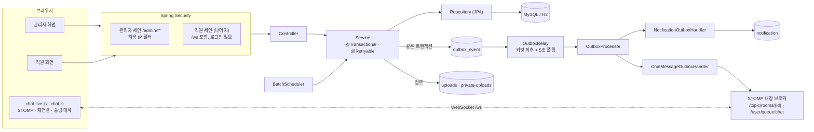

### DOC-02 로그인 분리

주소에 따라 체인이 갈리고, 비밀번호가 맞은 뒤에 계정 종류를 확인해요. 틀린 비밀번호와 계정 종류 오류를 구분해 주지 않아서 계정 종류가 드러나지 않아요.

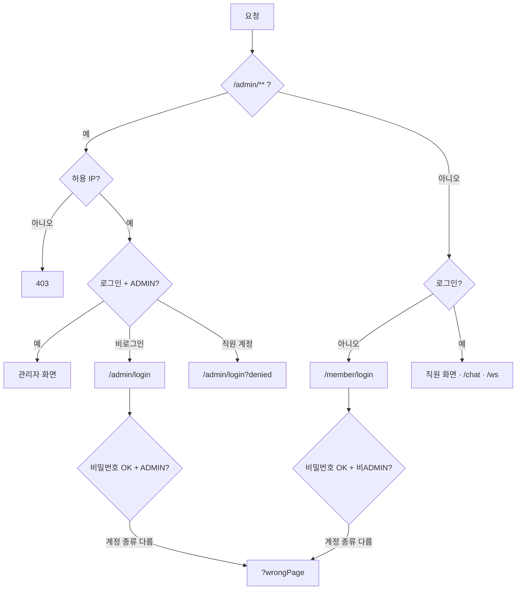

### DOC-03 요청 처리 공통 흐름

전처리에서 막히면 아무것도 저장되지 않아요. 트랜잭션 안의 업무 데이터와 Outbox 는 함께 커밋되거나 함께 롤백되고, 후처리는 커밋된 것만 처리해요.

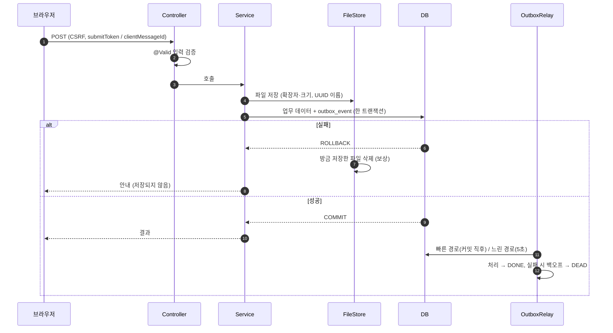

### DOC-04 채팅 메시지 전송

방 행을 잠그고 저장하기 때문에 **같은 방 안에서는 메시지 id 순서와 커밋 순서가 같아요**. 그래서 `afterId` 로 보정할 때 늦게 커밋된 메시지를 건너뛰는 일이 없어요. 전달은 "최소 한 번"이고, 화면은 메시지 id 로 중복을 걸러요.

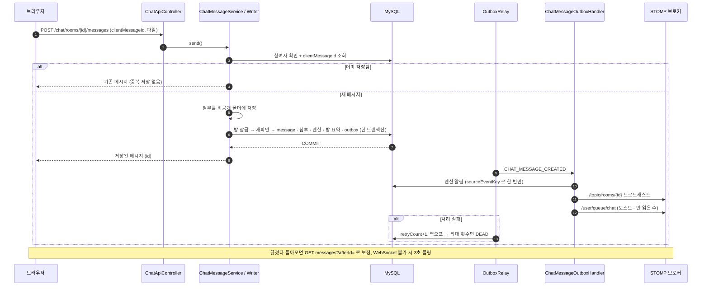

### DOC-05 이슈 상태 전이

상태 칩 메뉴(관리자)는 아래 화살표로만 움직여요. 상태 · 이력 · 알림 이벤트는 `BoardService.moveTo` 한 곳을 지나 한 트랜잭션으로 저장돼요. 기존 버튼(처리 시작, 해결 등록, 해결 취소)도 같은 곳을 지나요.

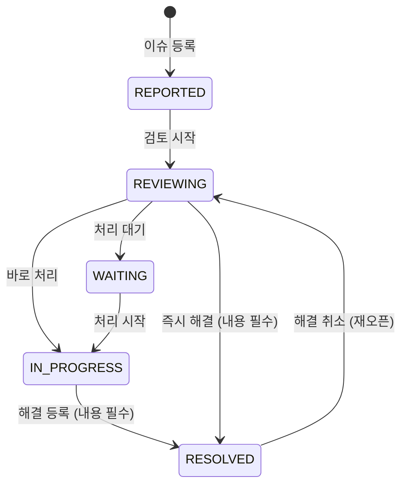

데이터 이전(`IssueStatusMigration`, 시작할 때마다 실행해도 같은 결과) : 예전 MySQL 컬럼은 `ENUM('IN_PROGRESS','OPEN','RESOLVED')` 이라 새 값을 넣을 수 없어요. 컬럼을 `VARCHAR(20)` 으로 넓히고 `OPEN → REPORTED` 로 옮겨요.

### DOC-06 Outbox 재시도 · DEAD · 수동 재처리

[5장](#5-transactional-outbox--재시도--dead--수동-재처리)의 상태도를 그대로 따르고, 채팅 이벤트도 같은 규칙이에요. 재처리 모니터에서 종류(알림 / 채팅 전송)로 거를 수 있고, 모든 재처리 경로는 `com.mysite.sbb.reprocess` 로거에 이벤트 id, 시도 횟수, 오류 요약을 남겨요.

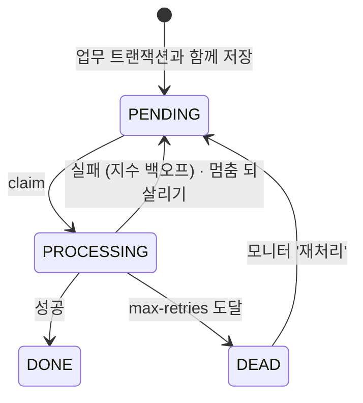

### DOC-07 배치 실행 기록과 catch-up

[6장](#6-배치-실행-기록과-복구-catch-up)의 그림과 같아요. 시작 순서만 더해졌어요.

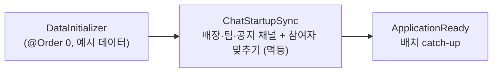

### DOC-08 내보내기

지금은 **필수 범위인 동기 내보내기**예요. 비동기 작업 테이블(ISS-16, REL-30)은 선택 항목이라 만들지 않았어요.

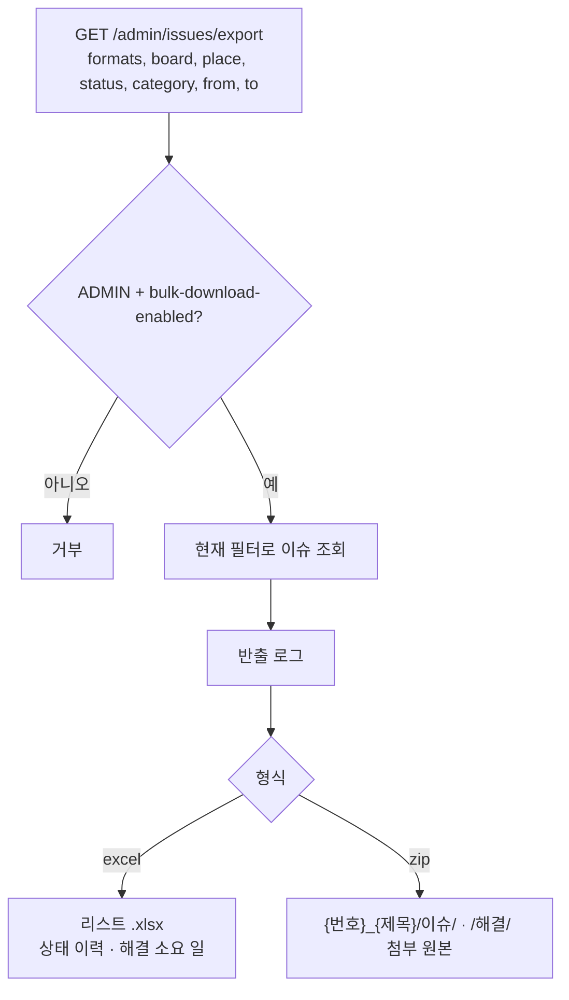

### DOC-09 장애 대응 (추가분)

[8장](#8-장애-대응-표)에 아래를 더해요.

| 실패 지점 | 생길 수 있는 문제 | 막는 장치 | 위치 |
|---|---|---|---|
| 응답 전에 네트워크 끊김 → 재전송 | 메시지 두 번 저장 | (room, sender, clientMessageId) unique, 기존 메시지 반환 | `ChatMessageService.send` |
| 저장 후 브로드캐스트 실패 | 실시간 유실 | Outbox 재시도, DB 에는 메시지가 있음 | `ChatMessageOutboxHandler` |
| 동시 전송의 커밋 순서 역전 | `afterId` 보정이 메시지를 건너뜀 | 방 행 잠금으로 전송을 줄 세움 | `ChatMessageWriter` |
| WebSocket 끊김 | 그동안의 메시지 유실 | 자동 재연결 + `afterId` 보정, 안 되면 폴링 | `chat-live.js`, `chat.js` |
| 같은 브로드캐스트가 두 번 | 화면 중복 | 메시지 id 로 거름 | `chat.js` |
| 읽음 요청 유실·역순 도착 | 읽음 위치가 뒤로 감 | 더 큰 값으로만 갱신 | `advanceRead` |
| 첨부 저장 후 DB 롤백 | 고아 파일 | 보상 삭제 | `FileStore` |
| 대화방에서 빠진 뒤에도 연결 유지 | 계속 메시지 수신 | 커밋 뒤 WebSocket 을 닫고 재구독 때 거부 | `ChatSessionRegistry` |
| 이슈 이력·알림 저장 실패 | 상태만 바뀜 | 상태·이력·이벤트 한 트랜잭션 | `BoardService.moveTo` |
| 이슈 상태 동시 변경 | 이력 어긋남 | 행 잠금, `@DynamicUpdate` 로 조회수 갱신이 상태를 덮어쓰지 않음 | `PostRepository.findByIdForUpdate` |
| 예전 ENUM 컬럼 | 새 상태 저장 실패 | 시작 시 VARCHAR 로 넓히고 데이터 이전 (멱등) | `IssueStatusMigration` |

### DOC-10 도메인 ER (추가분)

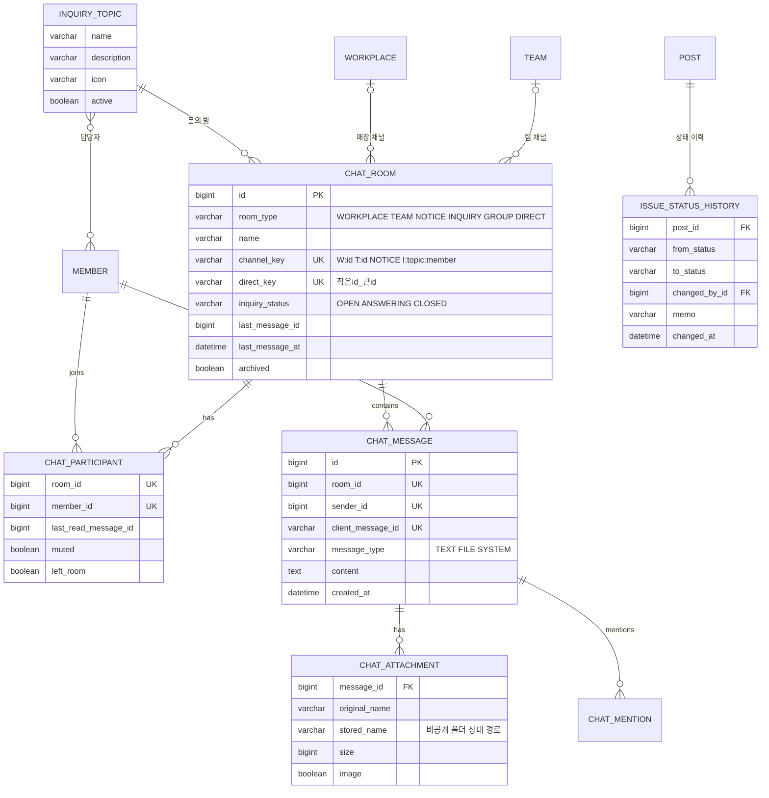

### 채팅 보안

| 항목 | 내용 | 위치 |
|---|---|---|
| 연결 | `/ws` 는 로그인 세션 필요, 같은 출처만, STOMP CONNECT 에 CSRF 토큰 필수 | `WebSocketConfig`, `WebSocketSecurityConfig` |
| 구독 | 정해진 주소만, `/topic/rooms/{id}` 는 현재 참여자만 | `ChatSubscriptionInterceptor` |
| 첨부 | 비공개 폴더 + 컨트롤러 권한 확인, 이미지만 inline, `nosniff` | `ChatApiController.attachment` |
| 이슈 첨부 | `/board/post/{id}/files/{name}` 로 제공, 팀 전용 글의 `/uploads/**` 직접 주소도 차단 | `BoardController.file`, `UploadAccessInterceptor` |
| 본문 | 화면은 `textContent` 로만 출력, http(s) 만 자동 링크 | `chat.js` |
| 관리자 | 1:1 은 건수만, 본문·참여자 화면 없음. Outbox 내용에도 메시지 id 만 | `ChatAdminService`, `ChatMessagePayload` |

여러 서버로 늘릴 때는 내장 브로커를 외부 STOMP 브로커(`enableStompBrokerRelay`)로 바꾸면 돼요 (범위 밖).
