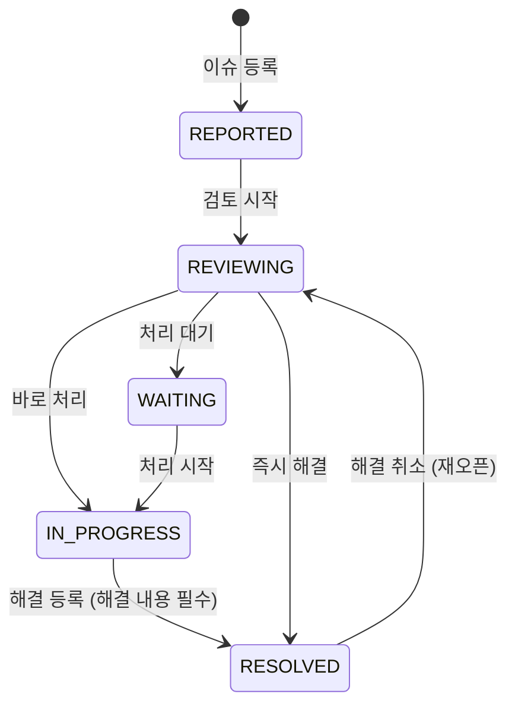
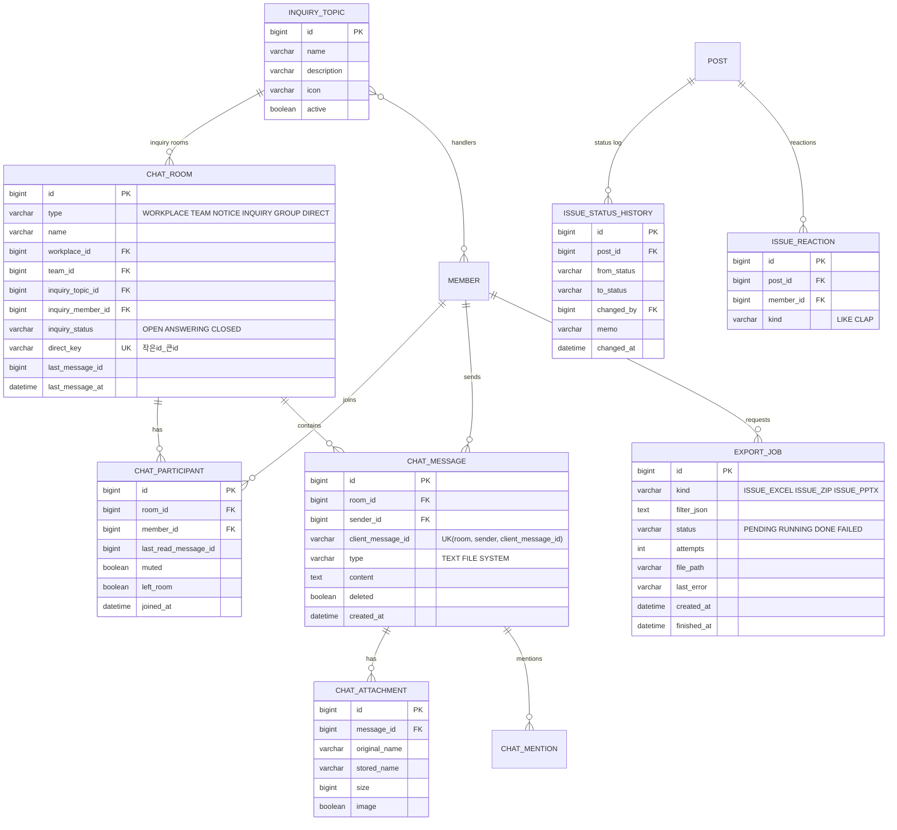
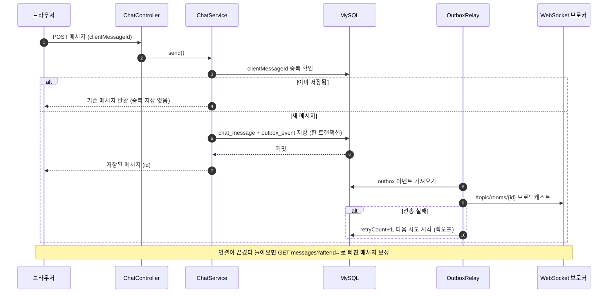

# InhaWorks 요구사항 명세서 (requirements.md)

> 문서 버전 : 1.1 (2026-11-23, 필수 항목 구현 상태 반영)
> 작성 근거 : 대표님이 첨부한 참고 화면 8장(image 7 ~ 14) + 추가 요구사항 + 현재 저장소(`README.md`, `docs/feature-inventory.md`, `docs/architecture.md`)
> 범위 : 이 문서는 **무엇을 만들어야 하는지**만 정의한다. 구현 방법의 세부는 `docs/architecture.md` 에서 다룬다.
> 참고 화면은 상용 서비스의 소개 화면이다. **기능 개념만 참고하고 서비스 이름, 로고, 문구, 색상, 인물 사진 등 브랜딩은 쓰지 않는다.**

---

## 목차

1. [개요](#1-개요)
2. [용어](#2-용어)
3. [사용자와 권한](#3-사용자와-권한)
4. [기술 · 개발 방식 요구사항](#4-기술--개발-방식-요구사항)
5. [기능 요구사항 현황 요약](#5-기능-요구사항-현황-요약)
6. [기능 요구사항 : 기존 기반 기능](#6-기능-요구사항--기존-기반-기능)
7. [기능 요구사항 : 이슈 관리 고도화 (참고 화면 7, 14)](#7-기능-요구사항--이슈-관리-고도화-참고-화면-7-14)
8. [기능 요구사항 : 사내 채팅 (참고 화면 8 ~ 12)](#8-기능-요구사항--사내-채팅-참고-화면-8--12)
9. [기능 요구사항 : 근무제별 스케줄 (참고 화면 13)](#9-기능-요구사항--근무제별-스케줄-참고-화면-13)
10. [신뢰성 요구사항 : 유실 · 실패 시 재처리](#10-신뢰성-요구사항--유실--실패-시-재처리)
11. [비기능 요구사항](#11-비기능-요구사항)
12. [데이터 모델 초안 (신규)](#12-데이터-모델-초안-신규)
13. [화면 · URL 목록 (신규)](#13-화면--url-목록-신규)
14. [아키텍처 문서 · 워크플로 도표 요구사항](#14-아키텍처-문서--워크플로-도표-요구사항)
15. [인수 기준](#15-인수-기준)
16. [개발 단계 (우선순위)](#16-개발-단계-우선순위)
17. [범위 밖](#17-범위-밖)
18. [부록 : 참고 화면 분석](#18-부록--참고-화면-분석)

---

## 1. 개요

| 항목 | 내용 |
|---|---|
| 시스템 이름 | InhaWorks · 사내 업무 관리 웹 |
| 목적 | 본사와 매장(현장) 직원이 할 일, 보고, 이슈, 소통, 근태를 한곳에서 처리하고, 관리자는 진행 현황을 한눈에 본다 |
| 사용자 | 관리자(본사), 매니저(점장·팀장), 직원(현장·사무실) |
| 접속 환경 | PC 브라우저, 모바일 브라우저 (반응형 웹, 별도 앱 없음) |
| 이번 문서의 핵심 추가 범위 | ① 이슈 관리 고도화 ② 사내 채팅 ③ 근무제 표시 보강 ④ 유실·실패 재처리 범위 확대 ⑤ 아키텍처 워크플로 도표 |

### 1-1. 추가 요구사항 원문 (대표님)

> 스프링 프레임워크를 공부하고 있기 때문에 프로젝트의 개발 방식대로 첨부 자료의 기능을 구현해줘.
> Java 21, MySQL, Spring Data JPA, Thymeleaf 기반 프로젝트 구성.
> 사내 업무 관리 웹 페이지로 구현해줘.
> 관리자 화면과 직원 화면을 로그인을 통해 분리해줘.
> db와 전처리 작업 후처리 작업 유실 혹은 실패시 재처리 방법도 찾아서 구현해줘. 그리고 이러한 아키텍처 전반적인 구조에 대해 워크 플로우 도표를 그려서 설명해줘.

위 원문은 아래 요구사항 ID 로 나누어 반영했다.

| 원문 | 반영 위치 |
|---|---|
| 프로젝트의 개발 방식대로 | TR-01 ~ TR-06 |
| Java 21, MySQL, Spring Data JPA, Thymeleaf | TR-01 |
| 사내 업무 관리 웹 페이지 | 1장, 5 ~ 9장 |
| 관리자 / 직원 화면을 로그인으로 분리 | 3장, SEC-01 ~ SEC-04 |
| DB · 전처리 · 후처리 유실·실패 시 재처리 | 10장 (REL-xx) |
| 아키텍처 워크플로 도표 | 14장 (DOC-xx) |

---

## 2. 용어

| 용어 | 뜻 |
|---|---|
| 근무지(매장) | 직원이 소속된 지점. 예) 강남점, 부산점 |
| 할 일 | 관리자가 반복 주기로 배정하는 체크리스트. 직원이 제출하고 검수자가 검수한다 |
| 보고서 | 관리자가 만든 양식(폼)에 직원이 작성하고 결재선이 결재한다 |
| 이슈 | 현장에서 올리는 문제 보고. 처리 단계를 거쳐 "해결"로 닫힌다 |
| 채널 | 여러 명이 함께 대화하는 채팅방 (매장 채널, 팀 채널, 전체 공지 채널, 문의 채널) |
| DM | 두 사람 사이의 1:1 채팅 |
| 문의 채널 | 직원이 관리자(담당 부서)에게 주제별로 문의하는 전용 채널. 예) 인사 문의, VM 문의, 영업 문의 |
| 전처리 | 업무 데이터를 DB 에 저장하기 **전** 단계. 입력 검증, 파일 저장, 중복 제출 확인 |
| 후처리 | 업무 데이터를 DB 에 저장한 **후** 단계. 알림 생성, 채팅 실시간 전송, 내보내기 파일 생성, 배치 |
| Outbox | 업무 변경과 같은 트랜잭션에 저장하는 "할 일 이벤트" 표. 커밋 후 별도로 처리한다 |
| DEAD | 재시도를 최대 횟수까지 해도 실패한 작업. 관리자가 수동으로 재처리한다 |

---

## 3. 사용자와 권한

| 역할 | 권한 문자열 | 로그인 화면 | 할 수 있는 일 |
|---|---|---|---|
| 관리자 | `ROLE_ADMIN` | `/admin/login` | 관리자 화면(`/admin/**`) 전체, 직원·조직·근무제 관리, 할 일·보고서 양식 관리, 게시판·채널 관리, 재처리 모니터, 모든 문의 채널 응대 |
| 매니저 | `ROLE_MANAGER` | `/member/login` | 직원 권한 + 검수자·결재자·문의 담당자로 지정되면 처리 |
| 직원 | `ROLE_USER` | `/member/login` | 할 일 제출, 보고서 작성, 게시판·이슈, 채팅, 근태 |

- 회원가입은 없다. 계정은 관리자가 만든다. 퇴사 처리된 계정은 로그인할 수 없다.
- 관리자 화면과 직원 화면은 **로그인 화면, 보안 필터 체인, 레이아웃(메뉴)** 이 모두 분리되어야 한다.

---

## 4. 기술 · 개발 방식 요구사항

| ID | 요구사항 | 비고 |
|---|---|---|
| TR-01 | Java 21, Spring Boot, Spring MVC, **Spring Data JPA**, **Thymeleaf**, **MySQL 8** 로 구성한다 | 현재 Spring Boot 4.1. MySQL 없이 실행·테스트할 때만 H2 프로필 사용 |
| TR-02 | 기존 sbb 프로젝트 방식대로 **기능별 패키지**(`com.mysite.sbb.<기능>`) 안에 `controller / service / repository / entity / dto / constant` 를 둔다 | 예) `chat`, `issue` 패키지 신설 |
| TR-03 | 화면은 서버 렌더링(Thymeleaf + 공통 레이아웃 `layouts/layout.html`)을 기본으로 하고, 실시간 기능(채팅)만 JavaScript 로 보강한다 | SPA 프레임워크 도입하지 않음 |
| TR-04 | 폼 입력은 DTO + Bean Validation(`@Valid`, `BindingResult`)으로 검증한다 | sbb 의 `QuestionForm` 방식 |
| TR-05 | 기존 디자인(`static/css/app.css`, 사이드바 + 상단바)을 유지하고 새 화면도 같은 컴포넌트를 쓴다 | 상태 배지 css(`st-*`) 재사용 |
| TR-06 | 새 라이브러리는 꼭 필요한 것만 추가하고, `build.gradle` 에 `// 추가(이유)` 주석을 단다 | 예) `spring-boot-starter-websocket` (채팅) |
| TR-07 | DB 스키마는 JPA 엔티티로 관리한다. 운영 MySQL 에 컬럼을 추가할 때 기존 데이터가 깨지지 않게 기본값을 둔다 | 현재 `ddl-auto: update` |
| TR-08 | 서비스 계층 테스트와 롤백 검증 테스트를 작성하고, 기존 테스트가 모두 통과해야 한다 | `src/test` |

---

## 5. 기능 요구사항 현황 요약

현재 저장소에 이미 구현된 기능과 이번에 새로 만들 기능을 구분한다.

| 영역 | 상태 | 이번 작업 |
|---|---|---|
| 로그인 분리 (관리자/직원), 관리자 IP 제한 | 구현됨 | 유지, 채팅 경로 보안 규칙만 추가 |
| 할 일 (배정 · 제출 · 검수 · 재작업 · 푸시 · 마감 알림 · 댓글) | 구현됨 | 유지 |
| 보고서 (폼 빌더 · 다단계 결재 · 엑셀 · zip) | 구현됨 | 유지 |
| 게시판 (일반 · 팀 전용 · 고정 공지 · 첨부 · 멘션) | 구현됨 | 유지 |
| 이슈 & 해결 게시판 (지점 필터 · 통계 · 타임라인) | 구현됨 | **고도화** : 상태 단계 세분화, 히스토리 다운로드(Excel/Zip/PPT), 링크 공유, 반응 |
| 근태 (출퇴근 · 근무제 7종 · 스케줄 · 휴가) | 구현됨 | **보강** : 근무제 칩을 직원 목록·프로필·채팅 프로필에 노출 |
| 알림 (Outbox 기반 앱 내 알림) | 구현됨 | 채팅 알림, 채널별 알림 끄기 추가 |
| **사내 채팅** | 없음 | **신규** |
| 재처리 (Outbox, 배치 catch-up, 보상 삭제, 멱등 토큰) | 구현됨 | **확대** : 채팅 전송, 내보내기 작업, 실시간 푸시 실패 |
| 아키텍처 문서 (Mermaid) | 있음 | 새 기능 흐름 도표 추가 |

---

## 6. 기능 요구사항 : 기존 기반 기능

이미 구현되어 있으며 **회귀(기능 퇴행)가 없어야 하는** 기준 목록이다. 상세 엔드포인트는 `docs/feature-inventory.md` 를 따른다.

| ID | 기능 | 핵심 동작 |
|---|---|---|
| BASE-TODO-01 | 반복 할 일 생성 | 주기(매일/매주 요일/매월 N일), 기간, 대상(직원 또는 근무지 전체), 검수자, 항목 종류(예/아니오, 체크박스, 사진, 서명, 객관식, 주관식) |
| BASE-TODO-02 | 자동 배정 | 매일 00:05 배치, (할 일, 직원, 날짜) 중복 없음 |
| BASE-TODO-03 | 제출 · 검수 · 재제출 | 제출 미완료 → 검수 대기중 → 검수 통과 / 재작업 필요(사유 필수) → 재제출 |
| BASE-TODO-04 | 완료율 · 상태 대시보드 | 할 일별 완료율, 직원별 상태 |
| BASE-TODO-05 | 푸시 재알림 · 마감 알림 | 미완료자에게만, 같은 요청은 한 번만 |
| BASE-RPT-01 | 보고서 폼 빌더 | 예/아니오, 체크박스, 이미지, 서명, 객관식, 주관식, 문서. 작성 대상·주기 안내·분류·해시태그 |
| BASE-RPT-02 | 다단계 결재 | 제출완료 → 검토중 → 검토완료, 어느 단계든 반려 |
| BASE-RPT-03 | 일괄 다운로드 | 엑셀, 첨부 zip (관리자, 다운로드 스위치) |
| BASE-BRD-01 | 게시판 | 일반·주제별·팀 전용, 고정 공지(전 직원 알림), 첨부, 댓글 @멘션 |
| BASE-BRD-02 | 이슈 & 해결 | 지점·상태·분류 필터, 처리 대기/해결 통계, 이슈 → 해결 타임라인 |
| BASE-ATT-01 | 근태 | 출퇴근, 근무제(고정·시차·선택·탄력·스케줄·재량·간주), 스케줄 배정, 주 52시간 경고, 휴가 신청·승인 |
| BASE-NTF-01 | 알림 | 헤더 안 읽은 수, 클릭 시 해당 화면 이동·읽음 |
| BASE-ADM-01 | 관리자 | 직원·팀·근무지 관리, 직원 허브(정보·근태·업무·서류·이력), 재처리 모니터 |

---

## 7. 기능 요구사항 : 이슈 관리 고도화 (참고 화면 7, 14)

### 7-1. 상태 단계 세분화

| ID | 요구사항 | 우선순위 |
|---|---|---|
| ISS-01 | 이슈 상태를 아래 5단계로 관리한다. 관리자는 상태 칩을 눌러 메뉴에서 단계를 바꾼다 | 필수 · 구현됨 |
| ISS-02 | 상태가 바뀔 때마다 **상태 변경 이력**(이전 상태, 새 상태, 바꾼 사람, 시각, 메모)을 남긴다 | 필수 · 구현됨 |
| ISS-03 | 상태가 바뀌면 글쓴이에게 알림, "해결 완료" 시 해결 내용이 필수다 | 필수 · 구현됨 |
| ISS-04 | 기존 데이터는 다음과 같이 옮긴다 : `OPEN` → 보고 완료, `IN_PROGRESS` → 처리 중, `RESOLVED` → 해결 완료 | 필수 · 구현됨 |
| ISS-05 | 통계의 "처리 대기 중" 카드는 해결 완료가 아닌 모든 단계를 합산한다 | 필수 · 구현됨 |

| 상태 (enum) | 라벨 | 의미 | 배지 |
|---|---|---|---|
| `REPORTED` | 보고 완료 | 현장이 이슈를 올림 | 파랑 |
| `REVIEWING` | 검토 중 | 담당자가 내용을 확인 중 | 주황 |
| `WAITING` | 처리 대기 중 | 처리 방법은 정해졌고 순서를 기다림 | 회색 |
| `IN_PROGRESS` | 처리 중 | 조치 진행 중 | 주황 |
| `RESOLVED` | 해결 완료 | 해결 내용 등록 완료 | 초록 |

### 7-2. 히스토리 다운로드

| ID | 요구사항 | 우선순위 |
|---|---|---|
| ISS-10 | 이슈 목록에서 현재 필터(지점, 상태, 분류, 기간) 그대로 **다운로드 형식**을 골라 받는다 | 필수 · 구현됨 |
| ISS-11 | 형식 ① **리스트 → Excel(.xlsx)** : 번호, 제목, 분류, 지점, 작성자, 등록 시각, 현재 상태, 상태 변경 이력, 해결자, 해결 시각, 해결 소요 일, 해결 내용 | 필수 · 구현됨 |
| ISS-12 | 형식 ② **이미지 & 문서 → Zip** : 이슈별 폴더(`{번호}_{제목}/이슈/`, `/해결/`)에 첨부 원본 | 필수 · 구현됨 |
| ISS-13 | 형식 ③ **이미지 → PowerPoint(.pptx)** : 이슈 1건 = 슬라이드 1장(제목, 지점, 상태, 이슈 사진, 해결 사진) | 선택 |
| ISS-14 | 여러 형식을 체크하면 한 번에 묶어(zip) 받는다 | 선택 |
| ISS-15 | 다운로드는 관리자만, 그리고 `app.security.bulk-download-enabled` 가 켜져 있을 때만 가능하다 | 필수 · 구현됨 |
| ISS-16 | 건수가 많으면(기준 : 이슈 200건 또는 첨부 100MB 초과) **비동기 내보내기 작업**으로 만들고 완료되면 알림으로 링크를 준다. 실패 시 재처리 대상이다 (REL-30) | 선택 |

### 7-3. 이슈 링크 공유

| ID | 요구사항 | 우선순위 |
|---|---|---|
| ISS-20 | 이슈 목록 각 행과 상세 화면에 **링크 복사** 버튼을 둔다. 누르면 이슈 상세 주소가 클립보드에 복사되고 "링크 복사됨" 토스트가 뜬다 | 필수 · 구현됨 |
| ISS-21 | 링크는 로그인한 사람 중 **그 게시판을 볼 권한이 있는 사람**만 열 수 있다. 권한이 없으면 안내 화면을 보여 준다 (외부 공개 링크 없음) | 필수 · 구현됨 |
| ISS-22 | 채팅 메시지에 이슈 링크를 붙이면 제목·상태 미리보기 카드로 보인다 | 선택 |

### 7-4. 이슈 & 해결 화면 보강 (참고 화면 14)

| ID | 요구사항 | 우선순위 |
|---|---|---|
| ISS-30 | 상단에 지점 칩(전체, 강남점, 부산점 …)과 통계 카드 2장 : **처리 대기 중**(건수, 미해결 기간 평균·최장 일) · **해결 완료**(건수, 해결 소요 기간 평균·최장 일) | 구현됨 · 유지 |
| ISS-31 | 상세 화면 : 상태 배너 → 제목 · 분류 · 지점 · 작성자 · 시각 → 타임라인(빨간 "이슈" 본문 + 사진·파일 카드 → 파란 "해결" 해결자 + 해결 내용 + 첨부) | 구현됨 · 유지 |
| ISS-32 | 타임라인 사이에 상태 변경 이력(ISS-02)을 작은 단계 점으로 보여 준다 | 필수 · 구현됨 |
| ISS-33 | 해결된 이슈에 **반응(👍 좋아요, 👏 수고했어요)** 을 남길 수 있다. 1인 1종류 1회, 다시 누르면 취소, 해결자에게 알림 | 선택 |

---

## 8. 기능 요구사항 : 사내 채팅 (참고 화면 8 ~ 12)

전화번호나 이메일을 몰라도 본사와 현장 직원이 바로 대화하는 기능이다. 직원 화면과 관리자 화면 모두에서 쓴다.

### 8-1. 채널 · 대화방

| ID | 요구사항 | 우선순위 |
|---|---|---|
| CHT-01 | 채팅 화면은 **왼쪽 대화방 목록 + 오른쪽 대화창** 2단 구조다. 모바일에서는 목록 → 대화창 1단으로 바뀐다 | 필수 · 구현됨 |
| CHT-02 | 대화방 종류 : `WORKPLACE`(매장 채널), `TEAM`(팀 채널), `NOTICE`(전체 공지 채널), `INQUIRY`(문의 채널), `GROUP`(직접 만든 그룹), `DIRECT`(1:1) | 필수 · 구현됨 |
| CHT-03 | 매장·팀 채널은 근무지·팀이 만들어질 때 자동 생성되고, 소속 재직 직원이 자동 참여한다. 직원의 소속이 바뀌면 참여자도 바뀐다 | 필수 · 구현됨 |
| CHT-04 | 전체 공지 채널은 전 직원이 참여하고 **관리자만 글을 쓴다**. 직원은 읽기만 한다 | 필수 · 구현됨 |
| CHT-05 | 대화방 목록 각 행 : 참여자 얼굴(최대 3), 대화방 이름, 참여 인원 수, 마지막 메시지 한 줄, 시각, **안 읽은 수 배지** | 필수 · 구현됨 |
| CHT-06 | 목록은 최근 메시지 순으로 정렬하고, 이름으로 검색한다 | 필수 · 구현됨 |
| CHT-07 | 새 대화 버튼 : 직원을 골라 1:1 또는 그룹 대화를 시작한다. 같은 두 사람의 1:1 방은 하나만 존재한다 | 필수 · 구현됨 |
| CHT-08 | 퇴사한 직원은 모든 대화방에서 빠지고, 지난 메시지에는 "(퇴사)" 표시가 붙는다 | 필수 · 구현됨 |

### 8-2. 인사 정보 연동으로 대화 시작 (참고 화면 9)

| ID | 요구사항 | 우선순위 |
|---|---|---|
| CHT-10 | 직원 프로필 카드(직원 목록, 조직도, 게시글 작성자 등에서 열림)에 사진, 이름, 직급, 근무지, **현재 근무 상태**, **채팅 버튼**을 보여 준다 | 필수 · 구현됨 |
| CHT-11 | 근무 상태는 오늘 출퇴근 기록으로 계산한다 : 출근 전 / **근무 중** / 퇴근 / 휴가 | 필수 · 구현됨 |
| CHT-12 | 채팅 버튼을 누르면 그 직원과의 1:1 방이 열린다(없으면 만든다) | 필수 · 구현됨 |
| CHT-13 | 전화 버튼은 관리자가 등록한 사내 전화번호가 있을 때만 `tel:` 링크로 보여 준다 | 선택 |

### 8-3. 메시지 전송 (참고 화면 10)

| ID | 요구사항 | 우선순위 |
|---|---|---|
| CHT-20 | 텍스트 메시지를 보낸다. Enter 전송, Shift+Enter 줄바꿈, 최대 2,000자 | 필수 · 구현됨 |
| CHT-21 | **파일 · 이미지**를 첨부한다. 이미지는 썸네일 미리보기, 그 외는 파일 카드(이름·크기)로 보인다. 한 번에 최대 10개, 개당 20MB | 필수 · 구현됨 |
| CHT-22 | **읽음 표시** : 내 메시지 옆에 아직 읽지 않은 사람 수를 숫자로 보여 주고, 1:1 방에서는 상대가 읽으면 체크 표시로 바뀐다 | 필수 · 구현됨 |
| CHT-23 | **멘션** : `@` 를 입력하면 그 대화방 참여자 목록(얼굴, 이름, 소속)이 자동완성으로 뜬다. 멘션된 사람은 방 알림을 꺼 놓았어도 알림을 받는다 | 필수 · 구현됨 |
| CHT-24 | 상대가 입력 중이면 "…" 입력 중 표시를 보여 준다 | 선택 |
| CHT-25 | 보낸 메시지는 5분 안에 삭제할 수 있다. 삭제된 메시지는 "삭제된 메시지입니다" 로 보인다 | 선택 |
| CHT-26 | 메시지는 위로 스크롤하면 이전 50개씩 더 불러온다 | 필수 · 구현됨 |
| CHT-27 | 같은 메시지가 두 번 저장되지 않는다. 클라이언트가 만든 `clientMessageId` 로 중복을 막는다 (REL-20) | 필수 · 구현됨 |

### 8-4. 실시간 수신 · 알림 (참고 화면 11)

| ID | 요구사항 | 우선순위 |
|---|---|---|
| CHT-30 | 새 메시지는 새로고침 없이 **1초 안에** 대화창과 목록에 반영된다 (WebSocket) | 필수 · 구현됨 |
| CHT-31 | WebSocket 연결이 끊기면 자동 재연결하고, 재연결 시 **마지막으로 받은 메시지 id 이후**를 다시 받아 빈틈을 메운다 (REL-21) | 필수 · 구현됨 |
| CHT-32 | WebSocket 을 쓸 수 없는 환경에서는 짧은 주기 폴링으로 대체한다 | 필수 · 구현됨 |
| CHT-33 | 다른 화면을 보고 있을 때 새 메시지가 오면 화면 구석에 미리보기 토스트를 띄우고, 사이드바 "채팅" 메뉴에 전체 안 읽은 수를 보여 준다 | 필수 · 구현됨 |
| CHT-34 | 브라우저 알림 권한을 허용한 사용자에게는 브라우저 알림(Notification API)을 보낸다 | 선택 |
| CHT-35 | **채널별 알림 끄기** : 대화방 행의 메뉴(모바일은 왼쪽으로 밀기)에서 알림 끄기/켜기, 나가기를 고른다. 알림을 끈 방은 목록에 종 모양 표시 | 필수 · 구현됨 |
| CHT-36 | 나간 방에는 새 메시지가 와도 다시 들어오지 않는다. 단 매장·팀·공지 채널은 나갈 수 없다 | 필수 · 구현됨 |
| CHT-37 | 채팅 알림은 기존 알림 목록(🔔)에는 쌓지 않는다. 멘션만 🔔 알림으로도 남긴다 | 필수 · 구현됨 |

### 8-5. 관리자에게 문의하기 (참고 화면 12)

| ID | 요구사항 | 우선순위 |
|---|---|---|
| CHT-40 | 관리자는 **문의 주제**를 만든다 : 이름, 설명, 아이콘, 담당자(관리자·매니저 여러 명), 사용 여부. 예) 인사 문의(급여, 휴가, 출퇴근), VM 문의(진열 자료), 영업 문의 | 필수 · 구현됨 |
| CHT-41 | 직원 채팅 화면의 "관리자와 채팅하기" 에서 주제를 고르면 **그 직원 + 해당 주제 담당자**만 있는 문의 방이 열린다. 직원·주제마다 방은 하나 | 필수 · 구현됨 |
| CHT-42 | 직원은 다른 직원의 문의 방을 볼 수 없다. 담당자는 자기 주제의 모든 문의 방을 본다 | 필수 · 구현됨 |
| CHT-43 | 관리자 화면에 **문의함**(주제별 탭, 미답변 / 답변 중 / 종료 필터, 마지막 문의 시각)을 둔다. 담당자가 답하면 "답변 중", 종료 버튼으로 "종료", 직원이 다시 쓰면 "미답변" 으로 돌아간다 | 필수 · 구현됨 |
| CHT-44 | 미답변 문의가 정해진 시간(기본 업무시간 기준 4시간)을 넘기면 담당자에게 다시 알린다 | 선택 |

### 8-6. 관리자 채팅 관리

| ID | 요구사항 | 우선순위 |
|---|---|---|
| CHT-50 | 관리자 화면 `/admin/chat` : 채널 목록(종류, 참여 인원, 메시지 수, 마지막 활동), 공지 채널 글쓰기, 문의 주제 관리 | 필수 · 구현됨 |
| CHT-51 | 관리자는 신고된 메시지를 숨김 처리할 수 있다. 숨김 이력은 남긴다 | 선택 |
| CHT-52 | 1:1 메시지 본문은 관리자 화면에서 열람하지 않는다 (개인정보). 통계(건수)만 본다 | 필수 · 구현됨 |

---

## 9. 기능 요구사항 : 근무제별 스케줄 (참고 화면 13)

근무제 7종과 스케줄 배정은 이미 구현되어 있다. 참고 화면처럼 **사람마다 근무제를 바로 알아보게** 보강한다.

| ID | 요구사항 | 우선순위 |
|---|---|---|
| SCH-01 | 직원 목록, 직원 프로필 카드, 채팅 프로필, 스케줄 화면의 직원 이름 옆에 **근무제 칩**(탄력 근로, 재량 근로, 간주 근로, 선택 근로 등)을 근무제 색으로 보여 준다 | 필수 · 구현됨 |
| SCH-02 | 직원 홈에 "내 근무제" 카드와 이번 주 근무 일정을 한눈에 보여 준다 | 구현됨 · 유지 |
| SCH-03 | 스케줄이 배정·변경되면 해당 직원에게 알림과 함께 매장 채널에 "근무표가 바뀌었습니다" 시스템 메시지를 남긴다 | 선택 |

---

## 10. 신뢰성 요구사항 : 유실 · 실패 시 재처리

> 원칙 : **"업무 데이터가 저장되었다면 후처리는 반드시 언젠가 한 번 실행되고, 저장되지 않았다면 후처리도 없다."**
> 모든 재처리는 **같은 작업을 여러 번 실행해도 결과가 한 번과 같도록(멱등)** 설계한다.

### 10-1. 실패 지점과 대응 (전체)

| 구간 | 실패·유실 상황 | 대응 방식 | 상태 |
|---|---|---|---|
| 전처리 | 입력 오류 | Bean Validation, 서비스 검증 → 저장하지 않고 화면에 사유 표시 | 구현됨 |
| 전처리 | 같은 폼 두 번 제출(더블 클릭, 새로고침) | 숨은 UUID `submitToken` + unique 제약 → 기존 결과 반환 | 구현됨 |
| 전처리 | 파일은 저장됐는데 DB 가 롤백 | 업로드 파일 **보상 삭제**(롤백 후 콜백) | 구현됨 |
| DB | 동시 수정 충돌(검수·결재) | `@Version` 낙관적 락 + `@Retryable` 새 트랜잭션 재시도 | 구현됨 |
| DB | 일시적 연결 끊김, 데드락 | `@Retryable` 지수 백오프(최대 3회) → 실패 시 사용자에게 "잠시 후 다시" | 구현됨 |
| 후처리 | 알림 생성 실패, 서버가 커밋 직후 종료 | **Transactional Outbox** : 업무와 같은 트랜잭션에 이벤트 저장 → 커밋 후 즉시 처리(빠른 경로) + 5초 폴링(느린 경로) | 구현됨 |
| 후처리 | 이벤트 처리 반복 실패 | 지수 백오프 재시도 → 최대 횟수 초과 시 **DEAD** → 재처리 모니터에서 수동 재처리 | 구현됨 |
| 후처리 | 처리 중 서버 종료(PROCESSING 고착) | 5분 넘은 PROCESSING 을 PENDING 으로 되살림 | 구현됨 |
| 배치 | 서버가 꺼져 자정 배치를 건너뜀 | `job_execution` 실행 기록 + 시작 시·10분마다 **catch-up** | 구현됨 |
| 채팅 | 전송 버튼을 눌렀는데 응답 전에 네트워크 끊김 → 재전송 | `clientMessageId` unique 로 중복 저장 방지 | 구현됨 (REL-20) |
| 채팅 | 저장은 됐지만 실시간 전송 실패 | 실시간 전송은 Outbox 후처리로, 실패해도 메시지는 DB 에 있음. 재연결 시 `afterId` 로 다시 받음 | 구현됨 (REL-21) |
| 채팅 | 읽음 처리 요청 유실 | 읽음 위치는 "마지막으로 읽은 메시지 id" 하나만 저장(더 큰 값으로만 갱신) → 다음 요청이 자동 보정 | 구현됨 (REL-22) |
| 내보내기 | Excel/Zip/PPT 생성 중 실패, 서버 종료 | 내보내기 작업 테이블 + 상태(PENDING/RUNNING/DONE/FAILED) + 재시도 + 모니터 재실행 | **신규 REL-30** |
| 이슈 | 상태 변경 이력 누락 | 상태 변경과 이력 저장을 한 트랜잭션으로 묶음 | 구현됨 (REL-40) |

### 10-2. 신규 신뢰성 요구사항

| ID | 요구사항 | 우선순위 |
|---|---|---|
| REL-20 | 채팅 메시지 저장 시 (`room_id`, `sender_id`, `client_message_id`) unique 제약을 둔다. 같은 키로 다시 오면 저장하지 않고 기존 메시지를 돌려준다 | 필수 · 구현됨 |
| REL-21 | 메시지 저장 트랜잭션에서 Outbox 이벤트 `CHAT_MESSAGE_CREATED` 를 함께 저장한다. 처리기는 ① WebSocket 브로드캐스트 ② 멘션 알림 ③ 안 읽은 수 갱신을 수행한다. 실패 시 기존 Outbox 재시도 규칙을 따른다 | 필수 · 구현됨 |
| REL-22 | 클라이언트는 재연결·화면 복귀 시 `GET /chat/rooms/{id}/messages?afterId=` 로 빠진 메시지를 받는다. 서버는 메시지 id 순서를 보장한다 | 필수 · 구현됨 |
| REL-23 | 실시간 브로드캐스트는 "최소 한 번" 전달이므로 클라이언트는 메시지 id 로 화면 중복을 거른다 | 필수 · 구현됨 |
| REL-30 | 대용량 내보내기는 `export_job` 테이블에 요청을 저장하고 별도 스레드에서 만든다. 실패 시 지수 백오프로 최대 3회 재시도, 이후 FAILED 로 두고 재처리 모니터에 노출한다. 30분 넘게 RUNNING 이면 고착으로 보고 다시 실행한다. 만든 파일은 7일 뒤 정리한다 | 선택 |
| REL-31 | 내보내기 파일은 임시 이름으로 쓰고 다 쓴 뒤 이름을 바꿔(원자적 교체) 반쯤 만들어진 파일을 내려받지 않게 한다 | 선택 |
| REL-40 | 이슈 상태 변경, 상태 이력, 알림 Outbox 이벤트를 하나의 트랜잭션에서 저장한다. 중간 실패 시 모두 롤백됨을 테스트로 검증한다 | 필수 · 구현됨 |
| REL-50 | 재처리 모니터(`/admin/monitor`)에 새 이벤트 종류(채팅, 내보내기)도 같은 표에서 보이고 재처리할 수 있어야 한다 | 필수 · 구현됨 (내보내기 작업은 선택 항목 REL-30 이라 제외) |
| REL-51 | 모든 재처리 경로(자동·수동)는 로그에 이벤트 id, 시도 횟수, 오류 요약을 남긴다 | 필수 · 구현됨 |
| REL-52 | 롤백 검증 테스트에 채팅 전송, 이슈 상태 변경, 내보내기 작업 실패 시나리오를 추가한다 | 필수 · 구현됨 (내보내기 작업은 선택 항목 REL-30 이라 제외) |

---

## 11. 비기능 요구사항

### 11-1. 보안

| ID | 요구사항 |
|---|---|
| SEC-01 | 관리자(`/admin/**`)와 직원(그 외) 보안 필터 체인을 분리하고, 로그인 화면도 따로 둔다 (구현됨) |
| SEC-02 | 관리자 화면 접속 IP 제한 : `app.security.admin-allowed-ips` 가 설정되면 목록 밖 IP 는 로그인 화면부터 차단 (구현됨) |
| SEC-03 | 일괄 다운로드(엑셀, zip, pptx)는 관리자만, 스위치가 켜져 있을 때만 가능 (구현됨, 이슈 내보내기에도 적용) |
| SEC-04 | WebSocket 연결은 로그인 세션이 있어야 하고, 구독 시 그 대화방 참여자인지 서버에서 확인한다 (구현됨) |
| SEC-05 | 채팅·이슈 첨부 파일은 공개 경로가 아닌 컨트롤러를 통해 내려주며, 대화방·게시판 접근 권한을 확인한다 (구현됨) |
| SEC-06 | 업로드 파일은 확장자 화이트리스트, 크기 제한, 저장 시 UUID 이름 사용 (경로 조작 방지) (구현됨) |
| SEC-07 | 모든 POST 는 CSRF 토큰을 유지한다. WebSocket(STOMP) 연결에도 CSRF 토큰을 헤더로 보낸다 (구현됨) |
| SEC-08 | 메시지 본문은 화면에 출력할 때 HTML 이스케이프한다 (XSS 방지). 링크만 자동 링크로 바꾼다 (구현됨) |

### 11-2. 성능 · 용량

| ID | 요구사항 |
|---|---|
| PERF-01 | 일반 화면 응답 1초 이내(직원 300명, 메시지 100만 건 기준) |
| PERF-02 | 메시지 목록은 (`room_id`, `id`) 인덱스로 페이지 조회한다. 안 읽은 수는 참여자별 `last_read_message_id` 로 계산한다 |
| PERF-03 | 이슈 통계는 지점 필터 포함 0.5초 이내 |
| PERF-04 | 내보내기는 1,000건 이하 Excel 기준 10초 이내 |

### 11-3. 사용성 · 화면

| ID | 요구사항 |
|---|---|
| UX-01 | 기존 디자인 시스템(사이드바, 상단바, 카드, 상태 배지, 토스트, 확인 모달)을 그대로 쓴다 |
| UX-02 | 1280px(PC)과 390px(모바일) 화면에서 모두 쓸 수 있다. 표는 좁은 화면에서 카드 목록으로 바뀐다 |
| UX-03 | 빈 상태, 오류, 로딩 상태를 화면마다 정의한다 |
| UX-04 | 버튼과 입력은 키보드로 조작할 수 있고, 아이콘 버튼에는 `aria-label` 을 단다 |

### 11-4. 운영

| ID | 요구사항 |
|---|---|
| OPS-01 | 설정은 `application.yml` 의 `app.*` 로 모은다 (예 : `app.chat.max-file-mb`, `app.export.retention-days`) |
| OPS-02 | 운영은 MySQL, 로컬 실행·테스트는 H2 프로필로 같은 코드가 동작한다 |
| OPS-03 | 로그는 `logback-spring.xml` 규칙을 따르고, 재처리 관련 로그는 별도 로거 이름을 쓴다 |

---

## 12. 데이터 모델 초안 (신규)

- 기존 `Post.issueStatus` enum 은 7-1 의 5단계로 확장한다.
- 기존 `Member` 에 `officePhone`(선택) 컬럼을 추가한다 (CHT-13).

---

## 13. 화면 · URL 목록 (신규)

### 13-1. 직원 화면

| 화면 | URL | 설명 |
|---|---|---|
| 채팅 | `GET /chat` | 대화방 목록 + 대화창 (2단) |
| 대화방 | `GET /chat/rooms/{id}` | 모바일 단독 화면, PC 는 `/chat` 안에서 열림 |
| 메시지 조회 | `GET /chat/rooms/{id}/messages?beforeId=&afterId=` | JSON, 이전 50개 / 빠진 메시지 |
| 메시지 전송 | `POST /chat/rooms/{id}/messages` | multipart, `clientMessageId` 필수 |
| 읽음 | `POST /chat/rooms/{id}/read` | `lastReadMessageId` |
| 알림 끄기 · 나가기 | `POST /chat/rooms/{id}/mute`, `POST /chat/rooms/{id}/leave` | |
| 1:1 시작 | `POST /chat/direct/{memberId}` | 있으면 기존 방으로 이동 |
| 문의하기 | `GET /chat/inquiry`, `POST /chat/inquiry/{topicId}` | 주제 목록, 문의 방 열기 |
| 프로필 카드 | `GET /members/{id}/card` | 조각(fragment) HTML |
| 이슈 링크 복사 | (화면 버튼) | `/board/post/{id}` 복사 |
| 이슈 반응 | `POST /board/post/{id}/reaction` | `kind` |
| WebSocket | `/ws` (STOMP) | 구독 `/topic/rooms/{id}`, 개인 `/user/queue/chat` |

### 13-2. 관리자 화면

| 화면 | URL | 설명 |
|---|---|---|
| 채팅 관리 | `GET /admin/chat` | 채널 목록, 공지 채널 글쓰기 |
| 문의 주제 | `GET/POST /admin/chat/topics` | 주제·담당자 관리 |
| 문의함 | `GET /admin/chat/inquiries?topic=&status=` | 미답변 / 답변 중 / 종료 |
| 이슈 상태 변경 | `POST /board/post/{id}/issue/status` | `status`, `memo` |
| 이슈 내보내기 | `GET /admin/issues/export?formats=excel,zip,pptx&place=&status=&category=&from=&to=` | 작으면 바로, 크면 작업 등록 |
| 내보내기 작업 | `GET /admin/exports`, `GET /admin/exports/{id}/download`, `POST /admin/exports/{id}/retry` | |
| 재처리 모니터 | `GET /admin/monitor` | 채팅·내보내기 이벤트 포함 (REL-50) |

---

## 14. 아키텍처 문서 · 워크플로 도표 요구사항

`docs/architecture.md` 에 아래 도표를 **Mermaid** 로 추가·갱신한다. 도표마다 "무엇이 일어나는지"를 한두 문단으로 설명한다.

| ID | 도표 | 종류 |
|---|---|---|
| DOC-01 | 전체 구조 : 브라우저(관리자/직원) → 보안 필터 체인 2개 → 컨트롤러 → 서비스 → 리포지토리 → MySQL, 옆으로 Outbox 릴레이 · 스케줄러 · WebSocket 브로커 | flowchart · 구현됨 |
| DOC-02 | 로그인 분리 흐름 : `/admin/login` 과 `/member/login`, IP 필터, 권한 없음 처리 | flowchart · 구현됨 |
| DOC-03 | 요청 처리 공통 흐름 : 전처리(검증·토큰·파일) → 트랜잭션(업무 + Outbox) → 커밋 → 후처리(빠른 경로/느린 경로) | sequence · 구현됨 |
| DOC-04 | 채팅 메시지 전송 : 전송 → 중복 확인 → 저장 + Outbox → 커밋 → 브로드캐스트 → 재연결 보정 | sequence · 구현됨 |
| DOC-05 | 이슈 상태 전이 (7-1) | stateDiagram · 구현됨 |
| DOC-06 | Outbox 재시도 · DEAD · 수동 재처리 | stateDiagram · 구현됨 |
| DOC-07 | 배치 실행 기록과 catch-up | flowchart · 구현됨 |
| DOC-08 | 내보내기 작업 : 요청 → 작업 저장 → 생성 → 실패 재시도 → 완료 알림 | flowchart · 구현됨 |
| DOC-09 | 장애 대응 표 (10-1 표를 최신화) | 표 · 구현됨 |
| DOC-10 | 도메인 ER (12장 반영) | erDiagram · 구현됨 |

예시 (DOC-04 의 기대 수준) :

---

## 15. 인수 기준

| 번호 | 시나리오 | 기대 결과 |
|---|---|---|
| AC-01 | 직원 계정으로 `/admin` 접속 | 관리자 로그인 화면 또는 권한 없음 안내 |
| AC-02 | 관리자가 이슈를 "검토 중" → "처리 대기 중" → "처리 중" → "해결 완료"(해결 내용 입력) 로 바꿈 | 각 단계 이력이 상세 타임라인에 보이고, 글쓴이가 단계마다 알림을 받음 |
| AC-03 | 이슈 목록에서 강남점 · 해결 완료 필터 후 Excel 다운로드 | 필터와 같은 건수의 행, 해결 소요 일 포함 |
| AC-04 | 이슈 첨부 Zip 다운로드 | 이슈별 폴더에 이슈/해결 첨부 원본 |
| AC-05 | 이슈 링크 복사 후 다른 팀 직원이 팀 전용 게시판 이슈 링크 열기 | 권한 없음 안내 |
| AC-06 | 두 브라우저에서 같은 매장 채널을 열고 한쪽에서 메시지 전송 | 다른 쪽에 1초 안에 표시, 읽으면 안 읽은 수 감소 |
| AC-07 | 전송 직후 네트워크를 끊고 같은 메시지 재전송 | 메시지는 하나만 저장 |
| AC-08 | 수신자 브라우저 연결을 끊은 상태에서 메시지 3개 전송 후 다시 연결 | 3개가 순서대로 모두 표시 |
| AC-09 | 알림 끈 방에 일반 메시지 / 멘션 메시지 도착 | 일반은 알림 없음, 멘션은 알림 |
| AC-10 | 직원이 "인사 문의" 선택 후 문의 | 인사 담당자만 보이는 방 생성, 관리자 문의함에 "미답변" |
| AC-11 | 직원 프로필 카드에서 채팅 버튼 | 1:1 방 열림, 두 번 눌러도 방은 하나 |
| AC-12 | 직원 목록·프로필 카드 | 근무제 칩이 근무제 색으로 표시 |
| AC-13 | Outbox 처리기를 강제로 실패시킴 | 백오프 재시도 → DEAD → 모니터에서 재처리 후 DONE, 메시지·알림 중복 없음 |
| AC-14 | 이슈 상태 변경 중 이력 저장에서 예외 발생 | 상태, 이력, 알림 이벤트 모두 롤백 |
| AC-15 | 내보내기 작업 중 서버 재시작 | 고착 작업이 다시 실행되어 DONE, 또는 FAILED 로 모니터 표시 후 재실행 가능 |
| AC-16 | 기존 테스트 전체 | 모두 통과 |

---

## 16. 개발 단계 (우선순위)

| 단계 | 내용 | 포함 ID |
|---|---|---|
| 1단계 | 이슈 상태 5단계, 상태 이력, 링크 복사, Excel/Zip 내보내기 | ISS-01 ~ 05, 10 ~ 12, 15, 20 ~ 21, 32, REL-40 |
| 2단계 | 채팅 기본 : 대화방·참여자·메시지·첨부·읽음·멘션, WebSocket + 폴링 대체, 재연결 보정 | CHT-01 ~ 08, 20 ~ 23, 26 ~ 27, 30 ~ 33, 35 ~ 37, REL-20 ~ 23 |
| 3단계 | 프로필 카드 · 근무 상태 · 1:1 시작, 문의 채널 · 문의함, 근무제 칩 | CHT-10 ~ 12, 40 ~ 43, 50, 52, SCH-01 |
| 4단계 | 재처리 모니터 확장, 롤백 테스트 추가, 아키텍처 도표 | REL-50 ~ 52, DOC-01 ~ 10 |
| 5단계 (선택) | PPT 내보내기, 비동기 내보내기 작업, 반응, 입력 중 표시, 메시지 삭제, 브라우저 알림, 미답변 재알림 | ISS-13 ~ 14, 16, 22, 33, CHT-13, 24 ~ 25, 34, 44, 51, SCH-03, REL-30 ~ 31 |

---

## 17. 범위 밖

- 네이티브 모바일 앱, 앱 푸시(FCM/APNs). 모바일은 반응형 웹으로 대응한다.
- 음성·영상 통화, 화면 공유.
- 외부(비로그인) 공개 링크.
- 메시지 종단간 암호화.
- 여러 서버로의 수평 확장(외부 메시지 브로커 Redis/RabbitMQ). 이번 범위는 서버 1대 + Spring 내장 STOMP 브로커이며, 확장 시 교체 지점만 문서에 적는다.
- 참고 서비스의 이름·로고·문구·인물 이미지 사용.

---

## 18. 부록 : 참고 화면 분석

| 화면 | 보이는 기능 | 반영 요구사항 |
|---|---|---|
| image 7 "고급 기능으로 더욱 손쉬운 이슈 관리" | 상태 지정 메뉴(보고 완료 · 검토 중 · 처리 대기 중), 다운로드 형식(리스트→Excel, 이미지&문서→Zip, 이미지→PowerPoint), 이슈별 링크 복사 | ISS-01 ~ 05, ISS-10 ~ 16, ISS-20 ~ 22 |
| image 8 "연락처 없이도 현장 직원과 바로 채팅" | 모바일·웹 동기화, 매장 채널, 전체 공지 채널, 1:1, 팀 채널, 대화방별 안 읽은 수, 첨부 | CHT-01 ~ 08, CHT-21, CHT-30 |
| image 9 "인사 정보 연동으로 빠른 채팅 시작" | 프로필 카드(근무 중 상태, 직급), 전화·채팅 버튼, PC·모바일 어디서나 | CHT-10 ~ 13, UX-02 |
| image 10 "현장과 정확하고 빠른 소통" | 읽음 표시, 파일·이미지 첨부, @멘션 자동완성(이름 · 소속) | CHT-21 ~ 23 |
| image 11 "필요한 채널만 골라 실시간 알림" | 실시간 알림 미리보기, 대화방 밀어서 알림 끄기 · 나가기 | CHT-33 ~ 37 |
| image 12 "직원들의 사내 문의는 전용 채널로" | 관리자와 채팅하기 → 인사 문의 · VM 문의 · 영업 문의 주제 채널 | CHT-40 ~ 44 |
| image 13 "회사 근무제에 딱 맞게 근무 일정도 한눈에" | 직원별 근무제 칩(탄력 · 재량 · 간주 · 선택 근로) | SCH-01 ~ 03 |
| image 14 이슈 & 해결 | 지점 칩, 처리 대기 중 / 해결 완료 통계, 상태 배너, 이슈 → 해결 타임라인, 첨부 카드, 반응 이모지 | ISS-30 ~ 33 |
